# CodeArchitect Intent Algebra: Bottom-Up Primitive Discovery for Human-Readable Code Explanations
**September 30, 2026 – In progress**
**Status**: In progress — corpus access verified; deterministic 200-, 1,000-, 4,000-, and 10,000-diff experiments have run through GumTree extraction, bounded gSpan discovery, semantic/code clustering, nested-sample stability analysis, downward semantic recursion, centroid-aware meaning grounding, TED-based expansion, semantic-first structural alignment, category-conditioned structural-rule induction, paired Semgrep/GumTree execution, a semantic–structural feedback loop, broad component-category induction, an 80-repository static-code holdout, open-vocabulary gap expansion, cross-language static-structure validation, and residual-aware recursive static refinement; human calibration, independent-repository enrichment, broader paired-rule coverage, complete edit-tree MDL, and product benchmarks remain open

## 1. Business / Decision Context (The “Why”)

### Problem

CodeArchitect can already parse a codebase into structural units and ask an LLM to explain a selected unit in context. That approach is flexible, but the explanation layer has no stable vocabulary underneath it: equivalent code can be described differently, common behaviors must be inferred again, and there is no inspectable intermediate representation showing why an explanation was produced.

This project tests whether code explanations can be grounded in an **Intent Algebra**: a registry of small, reusable mappings from structural code changes to concise human meanings. The registry is learned bottom-up from recurring changes across real repositories instead of being authored from an assumed ontology.

The central product decision is whether a mined intent layer is accurate and broad enough to become deterministic scaffolding for CodeArchitect's later natural-language generation, rather than relying only on direct LLM summarization.

### Intended users and use

- Engineers reading an unfamiliar codebase would receive consistent explanations such as “validate the input before continuing” or “convert an API failure into a domain error.”
- Reviewers would see the behavioral intent of a change without first reconstructing every syntax-level edit.
- CodeArchitect's explanation engine would use matched primitives as grounded evidence for downstream prose, with the source pattern, supporting examples, and confidence available for inspection.
- Researchers or maintainers could audit, merge, split, relabel, or retire primitives without retraining an opaque end-to-end model.

### Success criteria

The Phase 1 artifact is useful only if it meets all of the following on repositories excluded from discovery:

1. **Coverage**: the registry resolves a substantial share of eligible Python and JavaScript changes to at least one accepted primitive.
2. **Precision**: a matched primitive's English meaning is entailed by the code change, not merely associated with its topic.
3. **Resolution**: overlapping matches usually resolve to one maximally specific explanation without duplicate or contradictory output.
4. **Stability**: renaming identifiers, moving a pattern to a new repository, or making syntax-preserving edits does not change its assigned intent.
5. **Compression**: composite primitives reduce the description length of held-out edit scripts after paying the cost of storing the composite.
6. **Human usefulness**: engineers prefer primitive-grounded explanations to a syntax-only baseline and find them at least as correct as the current direct-LLM baseline.

Numeric launch thresholds will be frozen after a pilot labels enough examples to estimate task difficulty. The following are initial targets, not achieved results:

| Criterion | Initial target | Measurement unit |
|---|---:|---|
| Primitive match precision | ≥ 0.90 | Human-labeled held-out matches |
| Meaning entailment | ≥ 0.85 | Majority agreement on held-out matches |
| Unique most-specific resolution | ≥ 0.90 | Eligible matched diffs |
| Valid identifier-renaming invariance | 100% | Generated positive probes |
| Unrelated-mutation rejection | ≥ 0.95 | Generated negative probes |
| Engineer preference over syntax baseline | ≥ 60% | Blinded pairwise judgments |

Coverage will be reported as an outcome rather than optimized to an arbitrary target. A system can obtain high coverage by creating vague primitives, so coverage must always be read next to precision, specificity, and abstention.

### Baselines

1. **Syntax-only edit baseline**: verbalize the normalized GumTree actions, for example “insert an `if` statement and a `raise` statement.” This measures the value added by intent induction.
2. **Current CodeArchitect baseline**: send the selected structural unit, its cached isolated meaning, and its file/project context through the existing LLM explanation path in `server/llm/meaning.js`. This is the practical product baseline.
3. **Direct diff-to-label LLM baseline**: ask the grounding model to name the intent directly from a before/after diff, without a registry. This isolates the benefits of reuse, consistency, and inspectability.
4. **Commit-message retrieval baseline**: use the nearest high-similarity training diff's cleaned commit phrase. This tests whether mining contributes more than example retrieval.

## 2. Data Snapshot

### Source and unit of analysis

- **Candidate source**: the private Hugging Face Storage Bucket [`ajorge2/commitpackft-bucket`](https://huggingface.co/buckets/ajorge2/commitpackft-bucket), copied from BigCode's CommitPackFT dataset. The bucket is mounted read-only at the ignored local path `.data/commitpackft`; file contents are fetched lazily rather than copied into Git.
- **Upstream selection**: CommitPackFT is a filtered subset of CommitPack. Its published construction code retains non-empty changed files within a model-token limit and favors commit subjects that begin with an approved imperative verb, are capitalized, contain at least four words, and pass a collection of message-quality filters. This makes the messages unusually useful for grounding but creates strong linguistic and change-size selection bias.
- **Verified fields**: every inspected Python/JavaScript record contains `commit`, `old_file`, `new_file`, `old_contents`, `new_contents`, `subject`, `message`, `lang`, `license`, and `repos`.
- **Phase 1 slice**: retain Python and JavaScript rows only, then apply the structural eligibility, noise-removal, and repository-independence rules below.
- **Provenance requirement**: record the upstream dataset revision and preserve each row's repository/license metadata. The dataset repository's MIT license must not be treated as proof that every underlying source file has the same license.
- **Available sampling unit**: one file-level before/after record keyed by a commit SHA. The slice contains one record per commit SHA, so it does not reveal whether the original GitHub commit changed additional files. The pilot can enforce the one-to-three-component boundary within the observed file; the strict commit-wide boundary requires later GitHub enrichment.
- **Eligible observed change**: a retained Python/JavaScript file change whose edits form one to three connected AST change components after GumTree action grouping. This replaces the ambiguous phrase “at most three AST subtrees.” Raw GumTree action count is not the boundary: one source-level change can create many insert/update actions.
- **Language scope**: Python and JavaScript in Phase 1. Language-specific syntax patterns may map to a shared cross-language meaning, but their executable matchers remain language-specific.

### Verified raw snapshot

Measured directly from the mounted JSONL files on September 30, 2026:

| Language | File size | Records | Distinct commit SHAs | Distinct repository names* | Empty old contents | Duplicate before/after pairs |
|---|---:|---:|---:|---:|---:|---:|
| Python | 135,858,935 bytes | 56,025 | 56,025 | 46,428 | 13,488 | 1,317 |
| JavaScript | 128,001,108 bytes | 52,989 | 52,989 | 62,089 | 754 | 841 |
| **Combined** | **263,860,043 bytes** | **109,014** | **109,014** | **104,460 unique across languages** | **14,242** | **2,158** |

\*Repository counts are descriptive, not independent support counts. `repos` is a comma-separated provenance list: 81,810 records name multiple repositories, and one JavaScript record names 4,452. This is consistent with duplicated or mirrored code being associated with multiple repositories.

The executable pilot pins the mounted bucket contents by SHA-256 because the storage-bucket mount does not expose a dataset revision id: Python `d167da37e1058371c48e057cd8815d03700c867dd8bcf58e61420d4dcd288d73`; JavaScript `968688a1163c2dbbced0d0f9cf1dd52bc0b626c2ad9b02ff23f5700b2e277f25`.

Additional checks found zero invalid JSON records, no missing required fields, no empty `new_contents`, no observed file deletions, and no old/new path changes. Median old/new character counts are 653/961 for Python and 792/889 for JavaScript; 95th-percentile old/new counts are 1,379/1,907 and 1,408/1,535 respectively. The raw records contain neither commit timestamps nor PR descriptions, so a time range cannot be recovered from the bucket alone and grounding must initially use `subject`/`message` only.

### Repository-disjoint static holdout

The component-category evaluation uses a different unit from discovery: 80 complete
post-change source files, split evenly between Python and JavaScript. It excludes all
10,000 discovery rows and every held-out row whose recorded repository aliases overlap
any alias observed in discovery. One deterministic bottom-hash file is retained per
remaining repository family, yielding 80 files from 80 recorded-name-disjoint
repositories. Test, generated, bundled, vendored, documentation, example, build, and
lockfile paths are excluded. The evaluator receives the file path and at most 3,200
characters of source, but no commit subject or message.

This is a stricter novelty check than a random row split, but it is not perfect GitHub
lineage isolation: disjoint names can still hide forks, mirrors, copied code, or renamed
repositories. The holdout therefore measures exploratory transfer, not final
independent-repository performance.

### Inclusion rules

- The before and after versions parse successfully.
- At least one semantic AST node changes after comments and formatting-only changes are removed.
- The retained change has one to three connected change components.
- The record can be assigned to exactly one inferred provenance group for leakage-safe splitting.
- The patch and metadata needed for the experiment can be retained under the corpus policy.

### Exclusion and cleaning rules

- Lockfiles, vendored dependencies, minified bundles, generated files, snapshots, compiled output, and formatter-only patches.
- Repository bootstrap and test-fixture churn that changes scaffolding without expressing a reusable code intent. Test logic itself should not be excluded categorically; setup boilerplate should be detected by path and structural repetition rules.
- Reverts and duplicate/cherry-picked patches for discovery-frequency counts. Exact or near-exact patches should share a canonical patch cluster.
- Bot-authored dependency upgrades unless a later experiment explicitly studies them.
- Files that fail parsing in either revision or require an unsupported language grammar.

Generated-file detection should combine path/name rules, GitHub Linguist metadata where available, minification/entropy heuristics, generated headers, and repeated-content hashes. Every exclusion reason should be counted so the final dataset is reproducible and selection bias is visible.

### AST change-component definition

For each file, GumTree produces mappings and actions (`Insert`, `Delete`, `Move`, `Update`). Actions are converted to a typed change graph containing:

- old and new AST nodes;
- GumTree old-to-new mappings;
- edit-action type and node role;
- parent/child and next-sibling edges;
- optional control-flow and data-flow adjacency added in a later ablation.

Two actions belong to the same change component when their affected nodes share an edited ancestor below the file root, or when their mapped statements are adjacent within a configurable AST distance. The exact ancestor and distance rule must be tuned on the validation split and then frozen. For the bucket-only pilot, an observed file record is eligible when its edit graph has one to three connected components. A later enriched corpus can apply the same rule across every file changed by the commit.

### Leakage and independence checks

- Split by repository family, not by commit. Forks and mirrors must be clustered before splitting.
- Detect duplicate commits with stable patch IDs and near-duplicate AST edit hashes.
- Keep all records from the same inferred provenance/fork family in one of discovery, validation, or test.
- Do not expand the comma-separated `repos` field into independent evidence. Initially treat one record's full repository list as one provenance group. Before claiming 50-repository support, enrich candidate occurrences with GitHub fork/mirror metadata and count independent connected provenance components rather than raw repository names.
- Fit pattern structure, thresholds, and label prompts on discovery/validation only. The held-out test split is used once for the final report.
- Report results both overall and by language, repository size, change-component count, and seen-versus-novel project family.

### Known data limitations

- Commit messages are noisy and may describe a whole commit rather than the retained file change. PR descriptions are not present.
- The dataset's imperative-verb message filter makes grounding easier but narrows the label distribution and risks teaching the system the upstream filter vocabulary rather than the full distribution of developer intent.
- The dataset provides file-level pairs, not complete commit patches; strict commit-wide atomicity and multi-file context cannot be measured without enrichment.
- Commit timestamps and parent SHAs are absent, preventing time-based splitting and direct merge/revert identification from the bucket alone.
- `repos` aggregates provenance across comma-separated repositories; raw repository counts are not independent observations and cannot directly satisfy the 50-repository threshold.
- Public GitHub over-represents open-source conventions and popular frameworks.
- The one-to-three-component filter intentionally favors local maintenance edits and will not represent architectural changes.
- A frequency floor of 50 repositories and 100 commits favors generic intents and may discard useful but less common security, concurrency, or framework-specific behavior.
- JavaScript syntax varies by ecosystem and build tooling; successful parsing does not guarantee that a change is semantically comparable across frameworks.

## 3. Experimental Design & Methods

### Questions and hypotheses

- **H1 — Reuse**: recurring AST change structures support stable intent labels across repository families.
- **H2 — Value beyond syntax**: intent primitives are judged more useful than literal edit-action descriptions while preserving or improving correctness.
- **H3 — Compositionality**: accepted composite patterns compress held-out edit scripts better than representing their constituent primitives independently.
- **H4 — Deterministic resolution**: a specialization lattice can suppress broader matched meanings and return one concise, maximally specific intent for most overlaps.
- **H5 — Structural grounding**: accepted patterns remain invariant under valid identifier renaming but reject structural counterexamples.
- **H6 — Product value**: supplying matched primitives to CodeArchitect's explanation layer improves consistency and factual grounding relative to the current direct-LLM path.

### End-to-end approach

1. **Collect and snapshot** commits and metadata into a versioned manifest.
2. **Parse both revisions** with pinned Python and JavaScript grammars.
3. **Extract GumTree edit scripts** and group edits into connected change components.
4. **Canonicalize change graphs** by replacing local identifiers with typed placeholders, normalizing equivalent literals only when semantics permit, and retaining operator/control-flow distinctions.
5. **Mine frequent subgraphs with gSpan** on discovery repositories. gSpan operates on the typed before/after change graph, not on raw source text.
6. **Reduce candidates** to an operational generating set by removing exact duplicates, subsumed patterns with no incremental coverage or compression, and patterns that cannot be compiled into reliable matchers.
7. **Compile each candidate** to a paired before/after matcher. Semgrep can efficiently prefilter each revision, but ordinary Semgrep patterns do not by themselves represent a GumTree edit. The executor must join a `before_pattern`, an `after_pattern`, and metavariable correspondence, then verify the edit relation.
8. **Process atomic candidates through the queue**, ground their meanings, and expand them with adjacent co-occurring edits.
9. **Build typed taxonomy relations**, run structural probes, and validate on held-out repositories.
10. **Export a versioned registry** with provenance, support counts, quality metrics, and executable rules.

### Queue and semantic-first expansion algorithm

The original queue constraint is preserved: newly discovered base candidates enter queue
`Q`; accepted composites do not become new global seeds. However, base primitives are
building blocks rather than the primary readable categories. Semantic categories take
precedence whenever a semantic grouping and a structural grouping overlap. Structural
patterns explain how a semantic category is implemented; they do not replace its name.

Expansion is therefore conditioned on a semantic category. The bases discovered by the
queue seed a structural search inside that category, and recursive composition attempts
to induce a general implementation rule with `AND` for recurring co-occurrence and `OR`
for alternative implementations:

```text
Q ← accepted irreducible base candidates
process Q to index every base occurrence
S ← semantically coherent, stability-qualified categories
for each semantic category s in S:
    anchors ← bases whose occurrences overlap s
    frontier ← mine structural neighborhoods around anchors within s
    for local_depth in 1..D:
        rules ← compose frontier with AND/OR relationships
        score rules by held-out semantic coverage, category precision,
                         structural coherence, support, and MDL
        accepted ← rules that improve the general explanation of s
        register s as primary and rules as traceable structural evidence
        frontier ← category-conditioned expansions of accepted rules
        stop when no rule improves held-out coverage/precision/MDL
```

`D` is a defensive maximum depth rather than the intended stopping condition. Normal
termination occurs when composition produces no category rule that improves held-out
coverage, precision, or MDL while preserving structural coherence. Every higher-order
rule stores its child primitive IDs and supporting sample IDs, preserving the trace
`semantic category → structural rule → primitive relationships → code diffs`. The finite
queue guarantee remains intact because recursive rules never become new global queue
seeds.

The one-to-three-component boundary applies only to discovering clean, irreducible queue
bases. It does not cap category-conditioned expansion. Once the bases overlapping a
semantic category are identified, its structural search may use changes with any number
of components and grow through connected co-edits or within-component neighborhoods.
Rule complexity is governed by held-out semantic coverage and precision, recurrence,
structural coherence, repository independence, and MDL—not by the base-discovery
component limit.

Adjacency initially means parent/child or sibling distance one in the change graph. Control-flow and def-use adjacency should be evaluated as separate ablations because they may improve semantic coherence while increasing mining cost and matcher complexity.

### Acceptance cutoffs

An accepted base or composite must appear in:

- at least **50 independent repository families**; and
- at least **100 patch-distinct commit diffs**.

A composite must also achieve at least **1.2× held-out description-length compression** relative to encoding its pieces independently. MDL must charge for the pattern itself to avoid rewarding memorization:

```text
independent_cost(P) = bits to encode all occurrences using constituent primitives
composite_cost(P)   = bits to encode the composite rule
                    + bits to reference it at its occurrences
                    + bits to encode residual/unmatched edits
compression_ratio(P) = independent_cost(P) / composite_cost(P)
accept when compression_ratio(P) ≥ 1.2
```

The exact code lengths and residual encoding must be fixed before looking at test results. Support and MDL should be computed on discovery data, confirmed on validation data, and reported with repository-clustered bootstrap confidence intervals.

### Defining the “minimal orthogonal generating set”

This phrase is a research goal, not yet an executable criterion. For Phase 1 it will mean a set in which:

- **Irreducible**: removing any structural constraint materially reduces held-out precision, or broadens the pattern into a different intent.
- **Non-redundant**: no other primitive has the same canonical graph, equivalent matcher behavior, and synonymous grounded meaning.
- **Incremental**: each primitive adds held-out coverage or MDL gain not already supplied by a more general accepted primitive.
- **Resolvable**: any remaining overlap is represented by an explicit specialization relation or causes abstention.

This operational definition should be used in code and evaluation; “orthogonal” should not be claimed solely from low graph similarity.

### Grounding meanings

For each accepted pattern:

1. Sample supporting commits across repository families rather than taking the most numerous repository's examples.
2. Extract the local before/after change, cleaned commit subject, and the relevant PR sentence when available.
3. Ask the LLM for a short verb-object phrase that is true of the structural change across the examples. The model must abstain when examples do not support one shared meaning.
4. Cluster paraphrases and select a canonical label without erasing meaningful distinctions.
5. Have human reviewers judge **entailment**, **specificity**, and **cross-example consistency** from the code changes. Metadata may help propose a label but cannot override the code.
6. Store the label, prompt/model version, sampled evidence IDs, agreement, and adjudication status in the registry.

Grounding output should favor statements such as “reject a missing input” over implementation narration such as “insert an if and raise,” and avoid causal claims not established by the diff.

### Structural probing

The proposed 100% permutation test becomes one positive test family rather than the complete validity criterion:

- **Alpha-renaming probes**: consistently replace user-defined identifiers with fresh parse-valid tokens. Every valid probe must continue to match.
- **Typed literal probes**: replace literals only within a semantics-preserving class. `null`, booleans, status codes, sentinels, and boundary constants must not be abstracted automatically because they often carry the intent.
- **Formatting and equivalent-syntax probes**: vary whitespace, quote style, and safe syntactic sugar supported by the language.
- **Negative structural probes**: remove the guard, invert the comparison, move the effect outside the guarded branch, or replace the raised error with an unrelated side effect. These should stop matching when the primitive's meaning depends on that structure.
- **Metamorphic expectation**: positive probes preserve both match and label; negative probes either resolve to a different primitive or abstain.

### Taxonomy and lattice design

The initial four-field schema is useful for presentation but has a direction conflict: a guard-plus-raise pattern is **composed from** a check and a raise, while a more-specific child **specializes** a broader parent. These are different relations and must not share `contains`.

The executable registry should therefore use at least the following structure:

```json
{
  "id": "PRIM_GUARD_RAISE_001",
  "language": "python",
  "before_pattern": "...",
  "after_pattern": "if not $X:\n    raise $Y($MSG)",
  "output_meaning": "Reject an invalid state with an exception",
  "composes_from": [
    "PRIM_CHECK_CONDITION_001",
    "PRIM_RAISE_ERROR_004"
  ],
  "specializes": [
    "PRIM_GUARD_001"
  ],
  "is_specialized_by": [],
  "evidence": {
    "repository_support": 0,
    "commit_support": 0,
    "mdl_ratio": null,
    "grounding_agreement": null
  }
}
```

Support values are zero here only to show that no mining run has occurred; this is not a registered primitive yet.

If the external API must retain the original four fields, `contains` and `is_contained_by` should represent specialization edges only, while composition is stored separately in internal metadata. The terms must have one fixed direction:

- `contains`: immediate, more-specific specializations of this primitive;
- `is_contained_by`: immediate, broader parents of this primitive.

### Deterministic overlap resolution

Given all matched primitives `M` for one change:

1. Remove any match for which a strictly more-specific matched descendant exists.
2. If one maximal match remains, emit it.
3. If several incomparable maximal matches are declared composable and their accepted composite also matches, emit the composite.
4. If several incomparable maximal matches remain with no accepted composite, emit the non-conflicting intents separately or abstain according to the evaluation policy; do not invent an intersection.

This is more general than checking only `A.contains ∩ B.contains`, because the relevant specialization can be multiple lattice levels below `A` and `B`. Resolution must use transitive descendants and must confirm that the candidate primitive itself matches the change.

### Validation strategy

- **Discovery split**: 70% of repository families; mining, initial grounding, and rule construction.
- **Validation split**: 15%; adjacency choice, expansion depth, matcher repair, and launch-threshold calibration.
- **Test split**: 15%; one final frozen evaluation. If corpus size or repository diversity makes these ratios unsuitable, change them before mining and record the decision.
- **Human evaluation**: at least two independent reviewers per sampled match, with a third reviewer adjudicating disagreement. Measure raw agreement and Krippendorff's alpha or a suitable categorical alternative.
- **Uncertainty**: bootstrap confidence intervals clustered by repository family, since commits within one repository are not independent.
- **Ablations**: no MDL filter; no repository-support floor; no commit/PR metadata in grounding; identifier-only canonicalization; one-hop versus multi-hop expansion; tree adjacency versus control/data-flow adjacency.
- **Static component transfer**: retrieve broad parents by code-to-definition embedding
  similarity, then have a constrained semantic judge choose zero, one, or two parents.
  A zero-parent decision must name the missing responsibility; those gaps are embedded
  and clustered so recurring omissions feed the next bottom-up discovery loop.

### Key tools and design choices

| Layer | Planned tool / representation | Role |
|---|---|---|
| Parsing | Tree-sitter / language-native AST checks | Stable syntax trees for Python and JavaScript |
| Edit extraction | GumTree | Before/after mappings and edit actions |
| Discovery | gSpan | Frequent subgraph mining over typed change graphs |
| Fast candidate filtering | Semgrep | Language-aware matching on before and after snapshots |
| Structural similarity | Normalized tree edit similarity | Candidate clustering; threshold starts at 0.75 |
| Meaning induction | Constrained LLM prompt | Shared verb-object phrase with abstention |
| Registry | Versioned JSON/JSONL | Patterns, meanings, relations, evidence, metrics |
| Evaluation | Python/JS harness + human labels | Coverage, precision, MDL, stability, resolution |

The 0.75 similarity threshold is provisional. The implementation must specify whether similarity is `1 - distance / max_tree_size`, which labels/edges count, and how moves are costed. Otherwise the threshold is not reproducible.

### Implemented pilot configuration

The first executable pass now pins and records the following choices:

- **Sampling**: the 100 cheap-filter-eligible rows per language with the smallest SHA-256 over language, commit SHA, and canonical before/after patch hash. This is deterministic and scans the full language file rather than taking the first rows.
- **Edit extraction**: GumTree 4.0.0 runs behind a long-lived Java worker so parser and matcher initialization is paid once rather than once per diff. Each action records side, node, ancestry, edited subtree, mappings, and parse-error counts.
- **Observed-file atomicity**: actions are grouped at their nearest statement/declaration/definition boundary; records with one to three groups are retained. This is a pilot rule awaiting human audit, not a final semantic definition.
- **Graph direction**: the selected gSpan backend is run in tested undirected mode. Each directed relation is therefore reified as a relation vertex joined by distinct `source` and `target` edges, preserving orientation without relying on an unvalidated directed-mining mode.
- **Discovery bound**: Submine 0.1.4's bundled C++ gSpan backend uses pilot support ≥5 and 3–6 vertices. A 3–10 vertex run was interrupted after more than 60 seconds; the 3–6 search completed in approximately 0.5 seconds.
- **Candidate pruning**: discard mined fragments with dangling relation vertices or no action/AST node, then retain support-closed patterns that have no strictly larger labeled supergraph with the same host-graph set.
- **Grounding handoff**: every surviving pattern is joined back to commit subjects, messages, code excerpts, and provenance. Meaning and human-review fields remain null until reviewed.
- **Human review workflow**: a local evidence-first reviewer presents every example as an aligned, line-numbered before/after diff with red/green and token-level highlights, collapses unchanged context, collects shared-intent, proposed meaning, entailment, specificity, confidence, and notes, and stores independent reviewer/candidate records with the grounding-queue hash.
- **Semantic-cluster review**: a separate local workflow shows every member diff for each embedding cluster alongside three competing noun-only interpretations and a custom option, then records shared-concept validity, fit, breadth, confidence, and notes without promoting the cluster into the primitive lattice.

## 4. Results (The Gold Mine for Resume Bullets)

### Deterministic corpus and AST pilot

The current results are pipeline-retention and discovery diagnostics, not an evaluation of explanation quality. No baseline has yet been scored for intent precision, coverage, or human usefulness.

| Stage / outcome | Python | JavaScript | Combined | Relative to raw corpus | Notes |
|---|---:|---:|---:|---:|---|
| Raw CommitPackFT rows | 56,025 | 52,989 | 109,014 | 100% | One file pair per commit SHA |
| After cheap deterministic filters | 41,333 | 50,794 | 92,127 | 84.5% retained | Additions, exact duplicate patches, generated/noisy paths and content, and bundles removed |
| Deterministic AST pilot sample | 100 | 100 | 200 | — | Bottom-hash sample from all 92,127 cheap-eligible rows |
| Retained with 1–3 observed-file components | 69 | 70 | 139 | 69.5% of pilot | Provisional atomicity rule |
| Rejected with >3 components | 31 | 25 | 56 | 28.0% of pilot | Indicates substantial non-atomic or over-segmented changes |
| Rejected for parser error nodes | 0 | 5 | 5 | 2.5% of pilot | All five occurred in the JavaScript sample |

Cheap filtering excluded 16,887 rows: 14,242 file additions, 1,802 duplicate patches after earlier filters, 652 noisy paths, 119 generated-file headers, 52 generated filenames, and 20 minified/bundle filenames. These counts are order-dependent exclusion counts, so they sum to the total removed but should not be interpreted as overlapping prevalence estimates.

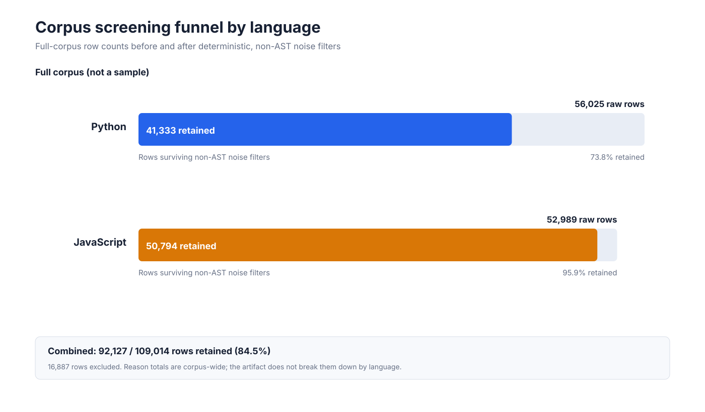

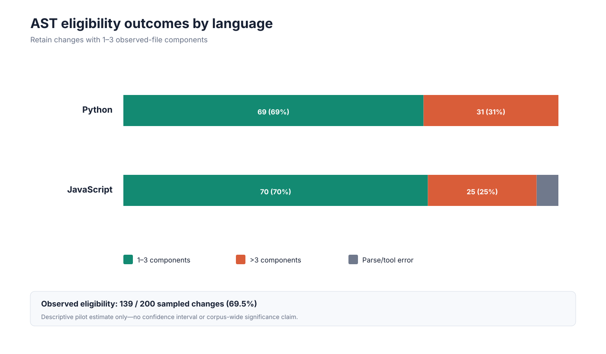

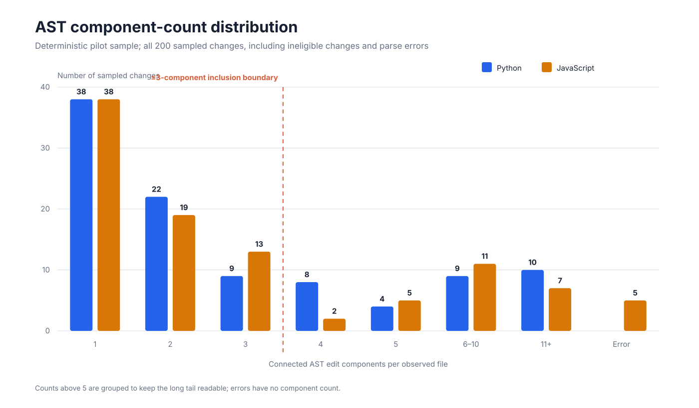

### Pilot discovery results

| Discovery step | Result | Interpretation |
|---|---:|---|
| Eligible change graphs | 139 | Input transactions for the pilot miner |
| Exact whole-change structural signatures | 126 | Most full edit shapes occur once at this sample size |
| Signatures repeated at least twice | 6 signatures / 19 changes | Only 13.7% of eligible changes belong to an exactly repeated shape bucket |
| Raw gSpan fragments, support ≥5, 3–6 vertices | 1,957 | Unpruned fragments are highly redundant |
| Structurally complete action/AST fragments | 48 | Removes dangling relation fragments and syntax-only motifs |
| Support-closed pilot candidates | 26 | Grounding-review queue after same-host-set supergraph pruning |
| gSpan runtime | ~0.5 seconds | On 139 graphs with the 3–6 vertex cap |
| 3–10 vertex exploratory run | >60 seconds; interrupted | Demonstrates the need for an explicit pattern-size/search budget |

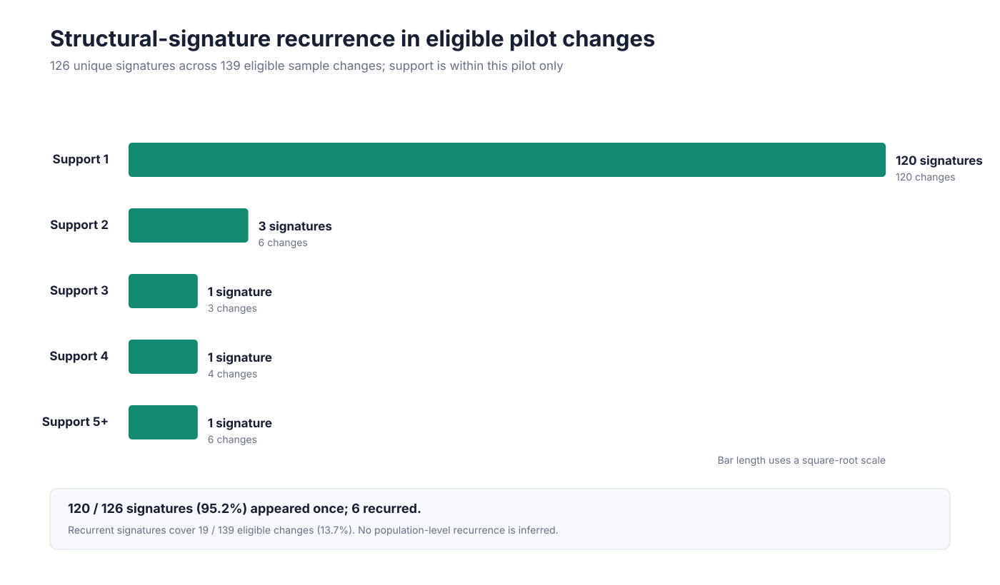

The most frequent support-closed candidates are still syntax-level abstractions: updating a string node (support 17), inserting an expression statement subtree (16), inserting a comma node (15), and updating an identifier (13). The evidence shows why structural frequency cannot be equated with human intent. For example, one repeated string-update shape covers a branch update, a package version change, a regular-expression fix, a React template update, and an authorization-policy correction. It therefore has no defensible shared intent beyond “update a string” and should be rejected or specialized rather than grounded into a misleading semantic label.

A smaller exact bucket of three JavaScript numeric updates is semantically coherent in this pilot—all increase test timeouts—but three examples do not meet registry thresholds and the structural pattern alone is too broad to entail that meaning. It is a useful candidate for expansion with call/property context, not an accepted primitive.

These findings support the core hypothesis only weakly so far: recurring structure exists, but the pilot confirms that the meaningful unit will often need a larger or better-typed composite than the smallest frequent fragment.

### Addition-dominant refinement

The first human pass rejected all four reviewed high-support candidates as lacking a shared intent (one reviewer, confidence 3/5). This is not yet a precision estimate, but the rejected candidates—string update, expression insertion, comma insertion, and string-fragment update—show that the original queue is dominated by edit mechanics. Review of the remaining baseline queue was paused rather than spending reviewer time on similarly under-specified fragments.

To test a more focused discovery cohort without overwriting the baseline, a change now qualifies as **addition-dominant** when it:

- still has one to three observed-file AST components;
- adds at least two AST nodes; and
- removes no more than 0.25 AST nodes per added node.

Insert/delete tree actions are weighted by subtree size. An update counts as one removed and one added node, preventing replacements from appearing additive. The thresholds are configurable and are treated as an ablation, not a settled definition of intent.

| Addition-dominant result | Python | JavaScript | Combined | Interpretation |
|---|---:|---:|---:|---|
| Original atomic cohort | 69 | 70 | 139 | Baseline one-to-three-component changes |
| Retained after removal/addition gate | 32 | 36 | 68 | 48.9% of the atomic cohort |
| Rejected by removal/addition gate | 37 | 34 | 71 | Balanced updates, deletions, or additions below two nodes |
| Exact structural signatures | — | — | 67 | Only one whole-change signature repeats |
| Raw gSpan fragments, support ≥5, 3–10 vertices | — | — | 6,663 | Deeper search became computationally feasible |
| Structurally complete fragments | — | — | 61 | Complete action/relation/AST fragments |
| Support-closed candidates | — | — | 27 | Still includes overlapping and low-semantic fragments |
| gSpan runtime | — | — | ~1.1 seconds | Versus >60 seconds for the original 139-graph 3–10 search |

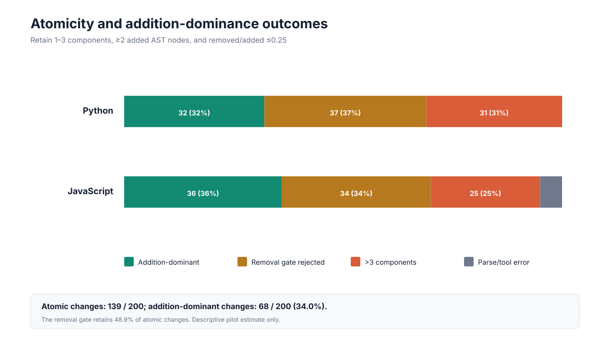

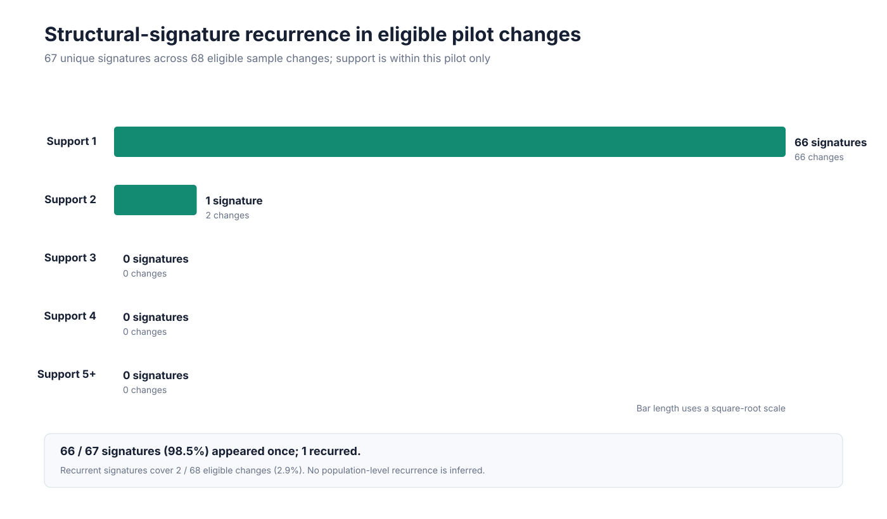

The refinement is useful but insufficient by itself. It removes the update-heavy string and identifier candidates and makes deeper mining inexpensive, surfacing more informative shapes such as inserting an `if` statement (support 6) and adding a keyword argument to a call (support 5). However, gSpan can still mine a comma, comment, or generic expression subgraph from an otherwise addition-dominant change. Candidate construction therefore needs a second gate requiring semantic context—such as the containing call and callee, condition and guarded behavior, assignment target, or return/exception role—before human grounding resumes.

### Two-resolution representation: facets and concepts

One taxonomy should not be forced to represent both precise edit mechanics and broad architectural subject matter. The revised design separates:

1. **Orthogonal local facets**: operation, noun-only edited entity, and semantic container. For example, `insert` + `conditional guard` + `function` keeps the verb out of the category name and allows the same entity to participate in insert, delete, update, or move operations.
2. **Overlapping macro-concepts**: deliberately fuzzy topics inferred from changed identifiers, string fragments, file paths, and commit subjects. Examples include authentication, URLs, configuration, caching, storage, or database behavior. These are annotations and clustering dimensions, not lattice primitives.

The layers are connected through provenance-bearing orthogonal relationships rather
than by promoting a semantic cluster into a primitive. Each change is represented as a
full `operation → edited entity → structural container` signature. Within a semantic
cluster, recurrent pairwise links (`operation↔entity`, `entity↔container`, and
`operation↔container`) are aggregated with supporting sample IDs. The resulting trace is
`semantic concept → orthogonal relationship → sample ID → highlighted before/after
code`, so a human-readable interpretation remains inspectable even when the cluster's
members use different exact edit structures.

The faceted extractor produced one record for each of the 68 addition-dominant changes. Primary noun entities were 21 function calls, eight object properties, seven conditional guards, six functions, five named arguments, four comments, and smaller import, literal, assignment, class, loop, and fallback groups. Each record also retains secondary entities, containers, AST churn, and source-separated concept tokens.

An initial soft-clustering probe used TF-IDF plus six-topic non-negative matrix factorization over recurrent concept tokens. It found one reasonably coherent `URL · authentication · link` topic (10 changes above the membership threshold) and a partially coherent `configuration · Git · options` topic (14). Other topics mixed unrelated examples, and the pilot contains only two `cache` token observations and one `db` observation. These are useful negative results: the macro layer is technically viable, but 68 deterministic samples are too sparse for stable architectural concepts such as database or cache. Corpus-scale concept exploration should therefore use richer context, embedding or hybrid lexical features, topic-coherence diagnostics, and soft/overlapping membership.

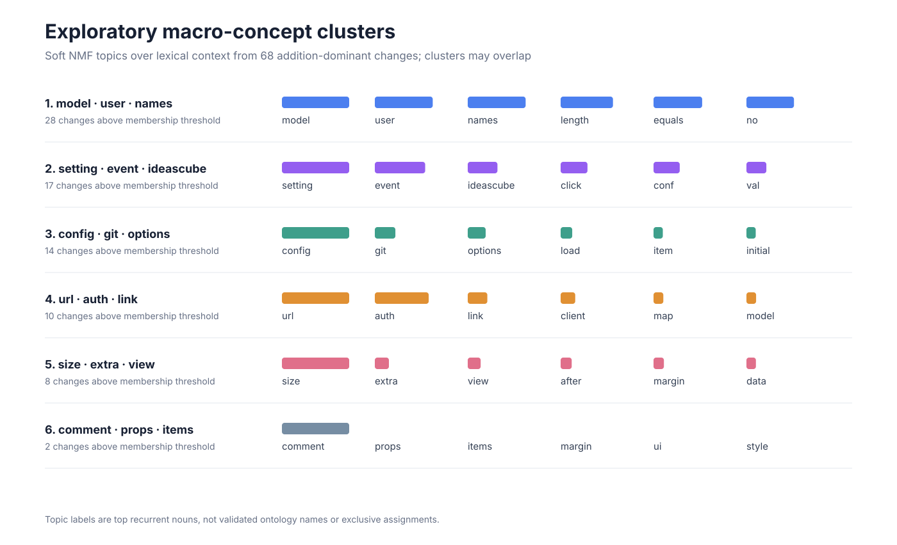

A second semantic baseline embedded commit text, paths, local structural facets,
changed identifiers/literals, and bounded before/after excerpts with
`text-embedding-3-small` at 512 dimensions. Cosine-distance average-linkage clustering
at the conservative 0.30 threshold produced six multi-record groups covering 18 of 68
changes; the other 50 remained singletons. The clearest groups captured four packaging
and `setup.py` changes, three API/authentication URL changes, and two layout-sizing
changes. A build/test-maintenance group of five changes remained semantically loose.
This is a useful improvement over token-only topics, but it reinforces the sample-size
warning rather than establishing an ontology: the threshold sweep ranged from only two
clustered records at 0.20 to 61 at 0.50, with increasing coverage bought by broader
merges. These clusters are auxiliary subject-matter annotations, never substitutes for
the per-base Semgrep → TED → gSpan structural expansion.

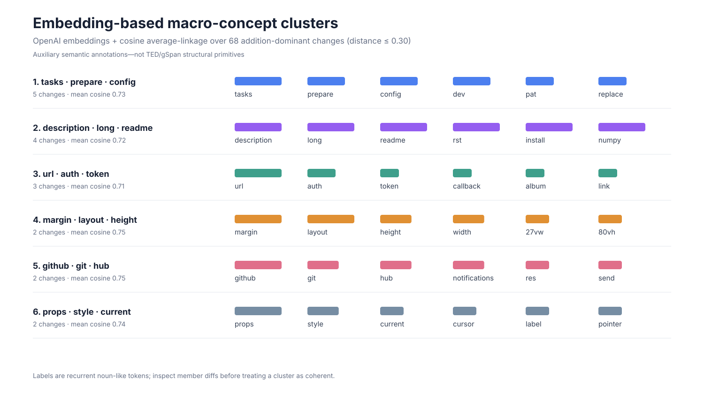

### Larger addition-dominant sweep (500 changes per language)

The first scale-up preserved the pilot's deterministic bottom-hash sampling and AST
churn gate while increasing the input from 100 to 500 changes per language. Of 1,000
sampled changes, 663 had one to three observed-file AST components and 336 also passed
the addition-dominant gate. The retained cohort contains 159 Python and 177 JavaScript
changes and 323 exact whole-change structural signatures.

| Larger-sweep stage | Result | Interpretation |
|---|---:|---|
| Raw mounted rows | 109,014 | Same pinned Python/JavaScript snapshot as the pilot |
| Cheap-filter eligible rows | 92,127 | 41,333 Python; 50,794 JavaScript |
| Deterministically sampled | 1,000 | 500 per language |
| One-to-three-component changes | 663 | 66.3% of sampled changes |
| Addition-dominant retained changes | 336 | 33.6% of sampled; 50.7% of atomic changes |
| Exact structural signatures | 323 | Whole-change repetition remains rare |
| Bounded gSpan candidates | 33 | Support ≥15; 3–6 vertices; 7.1-second run |
| Embedding clusters with ≥2 members | 39 | 137 changes clustered; 199 left as singletons |
| Recursive parent candidates | 6 | Four first-level, one second-level, one third-level |
| Parent candidates provisionally retained | 1 | Python build and packaging; 13 changes |

The clearest leaf concepts were Python package metadata and dependencies (11 changes),
build-task automation (9), AJAX interaction handling (4), interface layout (3), and
search-index metadata (2). The Python packaging and compiler/build-option leaves formed
one defensible parent candidate, **Python build and packaging**, spanning 13 changes.
All meanings remain provisional annotations: none reaches 100 patch-distinct commits,
and CommitPackFT's comma-separated repository provenance cannot establish 50 independent
repository families.

The pilot concepts behaved differently under scale-up. Python packaging and interface
layout recurred as recognizable clusters. The pilot's API endpoint wiring group split
into narrower Python URL-routing and authentication-endpoint leaves, which is preferable
to preserving a broad label. GitHub integration remained only a domain annotation. The
previously mixed tooling cluster separated a coherent nine-change build-task group from
a still-incoherent 16-change general configuration group. This is qualitative stability
evidence, not a formal resampling estimate.

The recursive loop is deliberately allowed to produce candidates that are later
rejected. At parent cosine distance 0.20, one first-level node combined 58 changes from
configuration, logging, build tasks, caching, GitHub, and testing. Its centroid was
numerically close but its meaning was not identifiable, so it and the broader 73- and
75-change descendants were rejected rather than assigned vague umbrella labels. This
is a useful stopping result: centroid similarity proposes merges, while semantic
identifiability, child relationships, support, and eventually MDL determine whether a
merge enters the taxonomy.

Every leaf stores its full `operation → entity → container` signatures and member sample
IDs. Every parent stores child cluster IDs plus the union of sample IDs. The resulting
trace is `proposed meaning → parent → leaf → orthogonal relationship → highlighted
diff`. Review decisions are versioned in
`experiments/intent-algebra/semantic-cluster-decisions.json` instead of being inferred
from the generated labels.


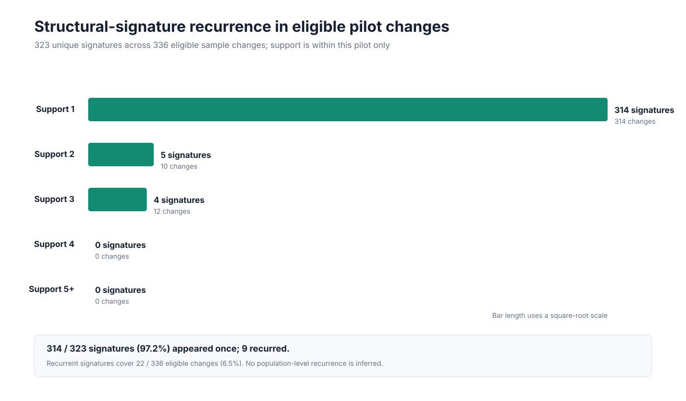

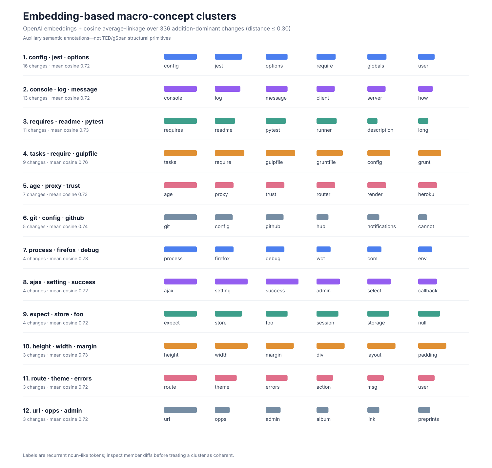

### Nested 2,000-per-language scale-up

The next rung sampled 2,000 diffs per language, preserving the same bottom-hash order,
noise rules, one-to-three-component definition, and addition-dominant gate. All 336
retained changes from the previous sweep occur in the new cohort, permitting exact
member tracking rather than an approximate comparison of cluster names.

| Scale-up stage | Result |
|---|---:|
| Deterministically sampled changes | 4,000 |
| One-to-three-component changes | 2,633 |
| Addition-dominant retained changes | 1,278 |
| Python / JavaScript retained | 634 / 644 |
| Bounded gSpan candidates | 32 |
| gSpan settings and runtime | support ≥50, 3–6 vertices, 107.4 seconds |
| Embedding clusters with ≥2 members | 169 |
| Changes in clusters / singletons | 672 / 606 |
| Recursive parent candidates | 23 across three levels |
| Flexible expansion corpus | 1,933 changes; 655 have >3 components |
| Maximum expansion-corpus component count | 32 |
| TED-grouped per-base co-edit candidates | 150 raw / 87 exact-deduplicated |
| Apparent co-edit candidates meeting 100-commit cutoff | 6 deduplicated (invalidated as support estimates by retrieval audit) |
| Constraint-retriever precision / recall on known queue hosts | 22.8% / 100.0% micro |
| Exact-host within-component candidates | 67 raw / 45 exact-deduplicated |
| Within-component cross-anchor intersections | 13 |
| Within-component candidates meeting 100-commit cutoff | 2 (both punctuation-only) |
| Semantic categories aligned against structural candidates | 169 against 77 |
| Categories with recurrent structural overlap (≥2 commits) | 9 |
| Strong provisional category rules (≥50% coverage and precision) | 0 |
| Downward semantic-refinement nodes | 199 from 169 roots |
| Accepted within-cluster semantic splits | 9; maximum depth 2 |
| Centroid-grounded nodes with support ≥6 | 30 |
| Meaning confidence levels | 15 high, 6 medium, 4 low, 5 abstain |

The strongest interpretable leaves now include Python package metadata and distribution
(42 changes), JavaScript build-task automation (30), test-runner configuration (7),
Redux state/reducer wiring (6), Django URL routing (6), and authentication endpoint
configuration (4). Python packaging grew from 11 to 42 members without losing any of
the earlier members. Build-task automation retained eight of nine earlier members and
grew to 30. In contrast, the earlier three-change interface-layout cluster split across
three destinations; its provisional interpretation was rejected.

Exact stability tracking classified 14 of the 39 earlier clusters as stable expansions,
six as membership-stable with a label shift, 13 as partial splits, two as splits, and
four as dissolved. The result reinforces the abstention policy: apparent coherence in a
two- or three-example cluster is not enough evidence for a reusable concept.

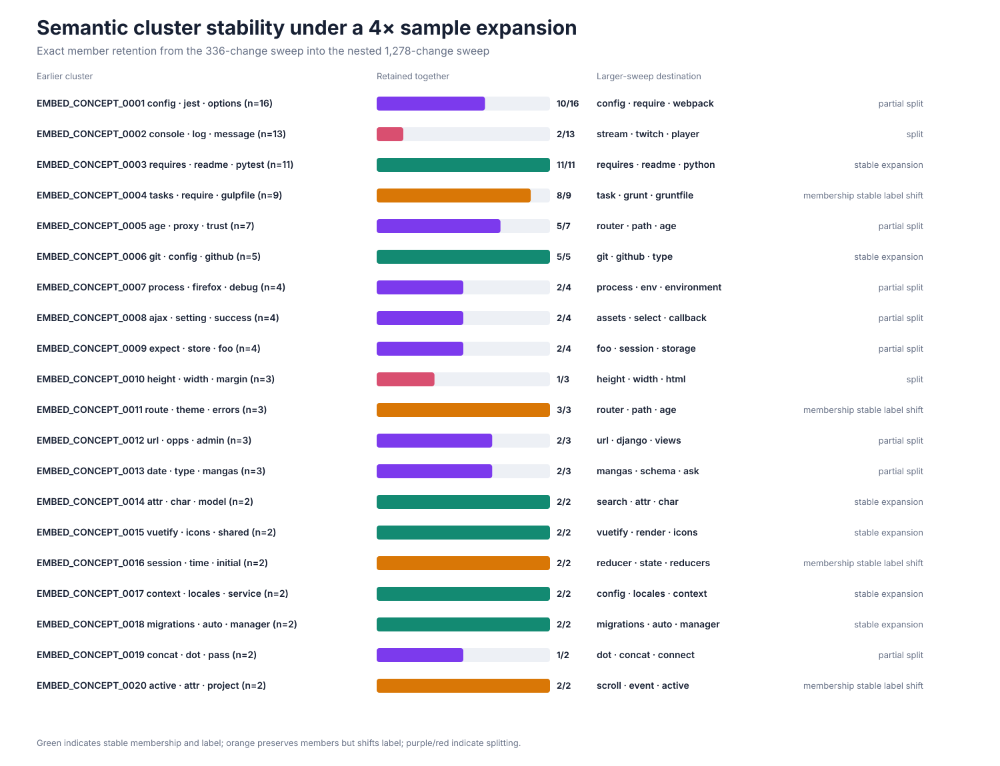

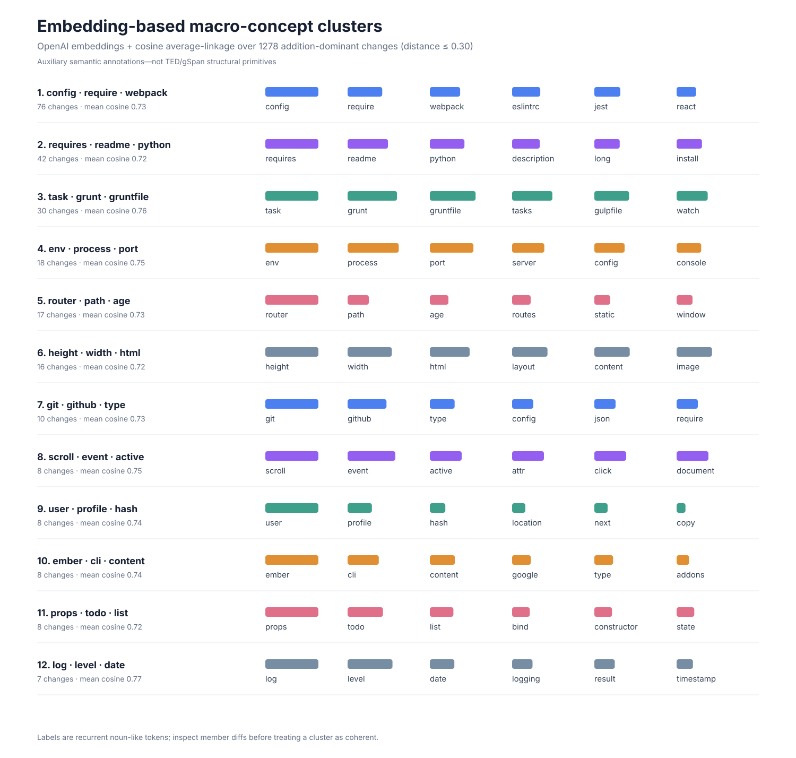

Recursive centroid grouping remained useful as a candidate generator but unsafe as an
acceptance rule. The largest first-level parent merged 286 changes spanning
configuration, task automation, routing, UI, Git, logging, and runtime concerns and was
rejected. One generated Python parent contained 47 changes, but three belonged to an
unrelated certificate/Python-version cluster. A curated child subset—42 packaging
metadata changes plus two package-resource changes—was retained provisionally as
**Python packaging and distribution** with full child/sample pointers. It is still not
a registered primitive.

The revised per-base expansion separates queue complexity from composite complexity.
Base discovery still uses the 1–3-component cohort, while each popped base searches a
separate 1,933-change addition-dominant expansion corpus with no component-count ceiling;
655 of those changes have more than three components and the largest has 32. Until
paired Semgrep rules exist, provisional action/type constraints retrieve base hosts.
The executor resolves the anchor, bundles all other observed-file components, computes
normalized ordered tree-edit similarity, and groups bundles at similarity ≥0.75.

The provisional constraint retriever produced 150 raw co-edit candidates (87 after
exact context/host-set deduplication) and six apparent deduplicated
100-commit candidates, but an explicit audit against the known gSpan host sets found
only **22.8% micro precision** (and 100% recall). Those six deduplicated counts are therefore not
valid support estimates and are not evidence of broadly supported composites. This is
the expected failure mode of replacing structural matching with broad action/type
constraints: the filter finds the true hosts but admits many false hosts. Exhaustively
re-mining all frequent subgraphs over the 1,933-host expansion corpus was stopped after
four minutes without completing, reinforcing the design requirement for indexed paired
Semgrep retrieval.

The exact-host within-component pass is more informative. It generated 67 raw
TED-grouped candidates from the 32 bases with perfect agreement to the original host
sets. Exact structure-plus-host deduplication reduced those to 45 unique candidates;
13 are cross-anchor intersections whose `contains` pointers reference two to five base
patterns. This is the first executable lattice-linking evidence in the pilot rather than
merely a planned schema. Candidate
contexts contain as many as 23 abstract tree nodes; 28 candidates reach at least ten
nodes, so the expansion representation is materially richer than its small base anchor.
Two candidates cross 100 commits, but both are comma insertions and fail the identifiable
intent requirement. More meaningful recurring shapes include `from ... import ...`
trees (support 56), import statements (44), keyword arguments (43), and assignment of a
list containing a string (32). These remain structural hypotheses rather than primitives:
they still require paired-rule retrieval across the flexible host corpus, repository
independence, semantic grounding, and MDL. Recurring co-component
bundles reached three added components in this sample—not because of a hard cap, but
because larger bundles did not repeat at least five times under the 0.75 TED threshold.

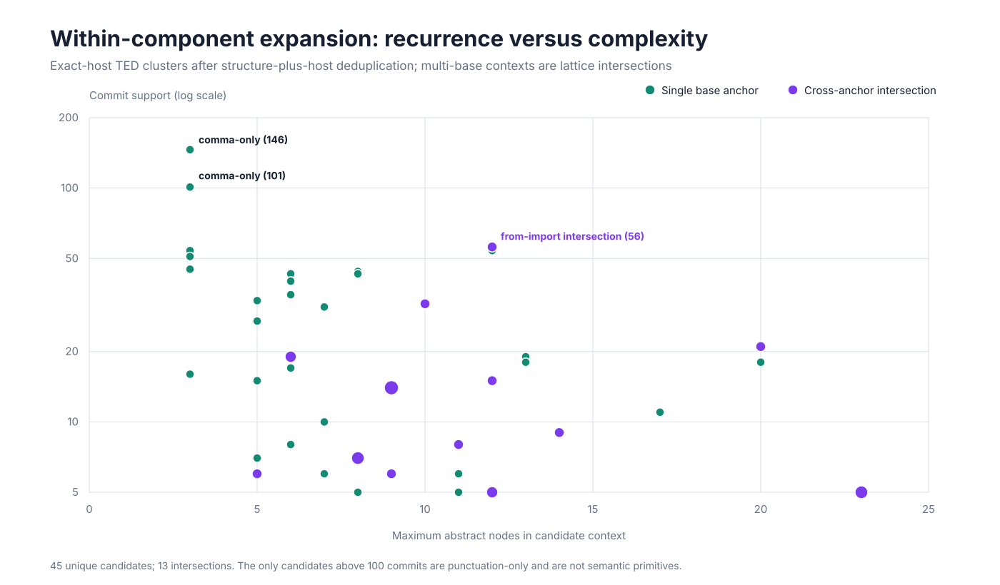

The semantic-first alignment joins all 169 embedding categories to the 32 bases and 45
unique composites by exact sample ID. Only nine categories have a repeated overlap of at
least two commits, and none currently has a rule with both at least 50% semantic coverage
and 50% category precision. This negative result changes the recursion target. Attaching
precomputed structural candidates after semantic clustering is insufficient; the next
pass must mine and compose structural neighborhoods *conditioned on each semantic
category*.

The packaging category illustrates the distinction. A keyword-argument base covers 26
of its 42 members (61.9% coverage), but only 31.7% of that base's global occurrences
belong to packaging. Recursive composition must add call, file, argument, and adjacent
edit relationships that preserve the category's coverage while excluding non-packaging
uses. The broad configuration category reaches 84.2% coverage with six OR clauses but
only 16.8% precision, another sign that semantic categories must guide the search for
discriminative structural context rather than inherit generic syntax clusters.

### Downward semantic-recursion harness

The recursion harness searches for more specific meanings *inside* each embedding
cluster rather than only merging cluster centroids upward. A parent is eligible when it
has at least six examples. Candidate cosine thresholds from 0.06 through 0.26 are tried,
and every child must contain at least three hard members. A split is accepted only when
it satisfies all of the following pilot gates:

- at least 60% of the parent is retained in non-trivial children;
- weighted within-child cosine cohesion improves by at least 0.03;
- cosine silhouette is at least 0.10;
- deterministic 80% subsample stability averages at least 0.55 adjusted Rand index;
- noun-label distinctness between children is at least 0.30.

The accepted hierarchy contains 199 nodes from 169 roots, with nine accepted downward
splits and a maximum observed depth of two. Examples include build-task automation
splitting into Grunt and Gulp families, then Grunt refining into task registration and
lint configuration; Python packaging splitting into dependency configuration, README
metadata, Django-related requirements, test requirements, and package inclusion; and
runtime-environment changes splitting into server-port, path/user, and process-env
groups. These noun labels remain provisional interpretations rather than accepted
meanings.

Hard sibling memberships are disjoint and drive recursion. A separate soft-membership
layer permits at most two sibling meanings per change, preserving semantic overlap
without allowing recursion to duplicate or cycle. Every node ranks the 77 existing
structural candidates by coverage, global purity, lift, and prevalence advantage over
its siblings. Hierarchy validation checks cycles, parent containment, hard-sibling
disjointness, the soft-membership cap, and reachability before writing the artifact.

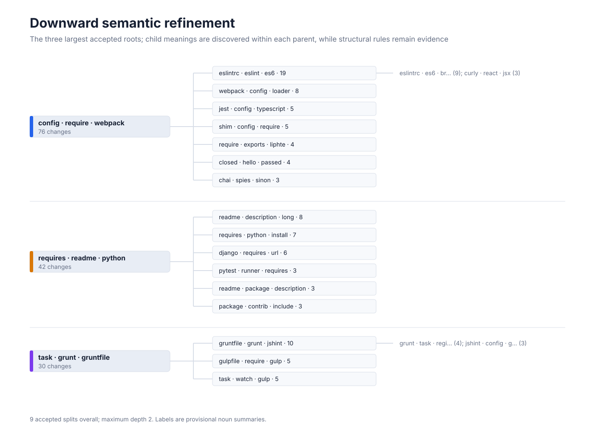

### Centroid-aware meaning inference

Meaning selection and confidence are one cumulative inference operation rather than a
manual naming pass followed by a separate universal validation pass. For each semantic
node with at least six hard members, the executor computes a 10%-trimmed centroid and
selects medoid, central, and boundary examples. An LLM proposes exactly three competing
noun-category meanings with definitions and may state that no non-trivial shared meaning
exists. The LLM does not supply confidence.

Each candidate definition is embedded in the same 512-dimensional space as the changes.
The winner combines centroid alignment with mean fit across every member. Reported
evidence includes member vote share, margin over the runner-up, 200-repeat bootstrap
winner stability, centroid cohesion, and outlier rate. High confidence currently requires
at least 75% member votes, 90% bootstrap stability, and a 0.02 winner margin; medium
requires 55%, 70%, and a positive margin. These thresholds are intentionally explicit
but remain heuristic and in-sample—not calibrated probabilities.

The 30-node pilot produced 15 high-confidence meanings, six medium, four low, and five
abstentions. Clear winners include **JavaScript task-runner infrastructure** (30 changes;
100% member vote, 0.083 winner margin), **Webpack toolchain configuration** (8; 100%,
0.092), and **Django URL routing configuration** (6; 100%, 0.127). The 42-change Python
packaging parent remains low confidence because **Python package setup configuration**
and **Package requirement metadata** nearly tie; its children resolve more clearly into
documentation metadata, runtime prerequisites, and Django distribution metadata.

Abstention is independent of geometric confidence. For example, a six-change URL-related
node gives one hypothesis 83% of member votes and a 0.076 margin, but the LLM identifies
separate URL construction, optional-object safety, pluralization, and taxonomy behaviors,
so the node remains abstained rather than receiving a fabricated common name. Every one
of the nine grounded parent/child pairs improves mean fit on the child's members relative
to the parent meaning, supporting the intended downward semantic refinement.

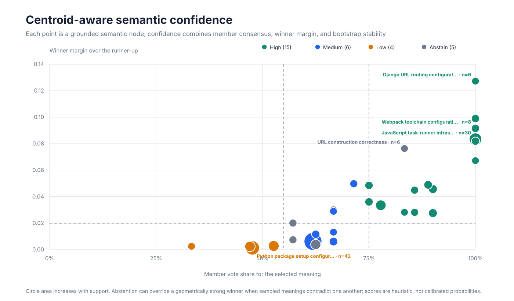

### Nested 5,000-per-language semantic sweep

The next deterministic tier sampled 10,000 diffs and retained 3,130
addition-dominant changes: 1,533 Python and 1,597 JavaScript. Because bottom-hash
sampling is nested, all 1,278 retained changes from the preceding tier remain directly
traceable in the larger cohort. Their cached embeddings were reused and only the 1,852
new retained changes required embedding requests.

| Larger-sweep measurement | Result |
|---|---:|
| Deterministically sampled diffs | 10,000 |
| Addition-dominant retained changes | 3,130 |
| Multi-record semantic clusters | 456 |
| Changes assigned to multi-record clusters | 1,883 |
| Changes left as semantic singletons | 1,247 |
| Earlier clusters stable with the same label family | 69 / 169 |
| Earlier clusters retaining members with a label shift | 19 / 169 |
| Earlier clusters partially split, split, or dissolved | 81 / 169 |
| Recursive semantic nodes | 545 from 456 roots |
| Accepted downward splits | 27, maximum depth 3 |
| Nodes eligible for meaning grounding | 77 |
| Meaning confidence levels | 34 high, 15 medium, 15 low, 13 abstain |
| Grounded child-parent pairs with positive specificity gain | 21 / 23 |

The larger sample strengthens several recurring categories. **Python package setup
configuration** grows to 86 members and becomes high-confidence; **Grunt and Gulp
workflow infrastructure** reaches 67 members and cleanly separates into high-confidence
Grunt and Gulp children; and Django URL configuration grows to 11 members with unanimous
member support for its selected meaning. Broader categories remain appropriately
uncertain: the 138-change JavaScript development-tool cluster abstains because runtime
input-safety boundary examples do not share its tooling meaning, despite a 95.7% member
vote for the leading hypothesis.

The run also exposed a missing recursive safeguard. Two of 23 grounded child meanings
fit their members no better than the selected parent meaning. The executor now requires
positive specificity gain before a child can exceed low confidence. This demoted an
otherwise high-confidence **Ember dependency integration** child; the other failing
child was already low-confidence. The 21 passing pairs remain candidates, not validated
taxonomy edges, until held-out calibration and structural-rule induction are complete.

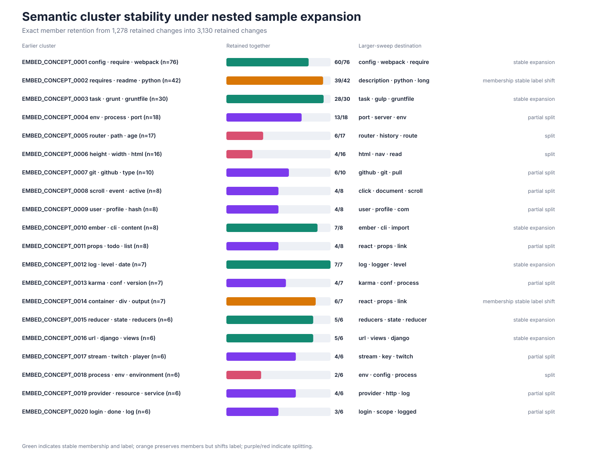

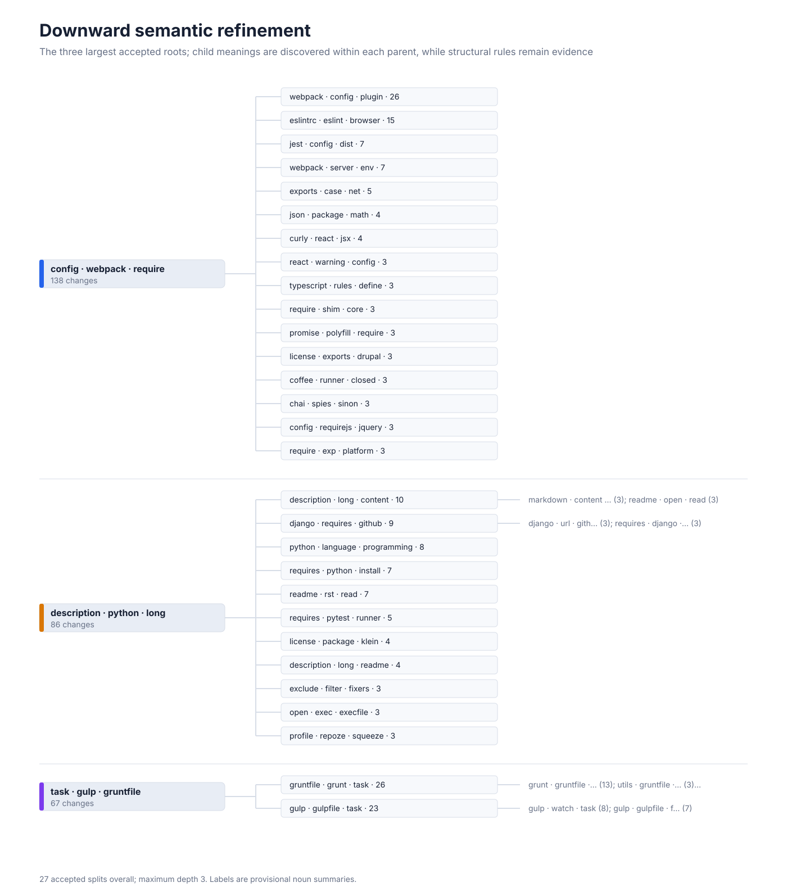

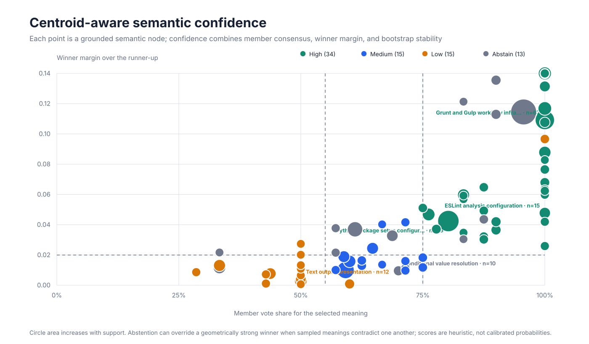

### Category-conditioned structural-rule induction

The next executor treats the 49 high- or medium-confidence semantic nodes as targets
and learns an `OR` of short `AND` clauses for each category. Candidate atoms describe
GumTree actions, edited AST node types, parent/child edges, ancestors, and change-component
types. Training and evaluation use three deterministic held-out folds, and a
language-specific category is compared with all other eligible changes in that language
rather than gaining trivial precision from a Python-versus-JavaScript distinction.

Four ablations expose where semantic traceability comes from:

| Rule evidence | Weak candidates after gates | MDL proxy ≥1.2× | Insufficient |
|---|---:|---:|---:|
| Name-invariant AST structure only | 2 | 0 | 47 |
| AST structure plus symbols inside edited subtrees | 4 | 0 | 45 |
| Structure plus untyped bounded excerpt anchors | 12 | 0 | 37 |
| Typed unchanged AST context frames | 9 | 2 | 40 |

The final tier stores up to three typed, 48-node AST neighborhoods around each edit and
streams the resulting JSONL so artifact size is not limited by one in-memory string. It
binds stable symbols to enclosing calls, arguments, objects, arrays, or assignments.
Its strongest retrieval results include **Trove taxonomy metadata** at 100% held-out
precision and 87.5% recall, **Python package setup configuration** at 73.6% precision and
77.9% recall, **Environment-aware port configuration** at 78.6% precision and 52.4%
recall, and **Webpack build configuration** at 65.4% precision and 65.4% recall. Every
clause retains supporting and false-positive sample IDs.

The experiment confirms that unchanged enclosing code matters. For example, an inserted
`python_requires` keyword has generic insertion structure; the enclosing `setup(...)`
configuration distinguishes packaging. Stable framework/API symbols therefore need an
explicit anchor role, while local identifiers remain metavariables. The original
identifier-permutation probe must distinguish these roles rather than randomizing APIs
and locals indiscriminately.

Before the semantic feedback loop, no rule qualified for registration. A held-out classification-MDL proxy encodes out-of-fold errors
plus average rule storage and compares that cost with directly encoding the category's
positive labels. Two rules exceed 1.2×: **Trove taxonomy metadata** at 1.95× and **Python
package setup configuration** at 1.37×. Trove has only eight examples; packaging remains
below the provisional 80% precision gate. Both are also far below the final 100-commit
and 50-independent-repository cutoffs. This is a conservative diagnostic, not the
proposal's final edit-script MDL, which must compare composite edit encodings against
their constituent structural pieces.

### Paired executable matcher check

The first two MDL-positive Python rules were compiled into executable before/after
Semgrep prefilters. The experiment reconstructed all 3,130 retained file pairs, scanned
the 1,533 Python pairs on both sides, joined the revision-level matches by sample ID,
and then required the learned GumTree clause to verify the edit relation. This preserves
the intended separation: Semgrep finds likely code contexts; GumTree confirms that the
required structural change actually occurred.

| Semantic category | Initial reference precision | Initial reference recall | Expanded-reference precision | Expanded-reference recall | Decision |
|---|---:|---:|---:|---:|---|
| Python package setup configuration | 75.3% | 70.9% | 93.8% | 75.2% | Strong provisional after feedback loop |
| Trove taxonomy metadata | 100.0% | 75.0% | 100.0% | 75.0% | Precise but under-supported |

These precision and recall values measure agreement with a semantic reference set, not
independently labeled intent truth. Against the original discovery cluster, the package
matcher found 61 members, 20 out-of-cluster matches, and missed 25 members. Inspection
showed that treating those 20 matches as false positives was incorrect: all 20 were
traceable setup/package changes such as dependency declarations, entry points, package
data, and distribution metadata. Their meaning-vector scores also fell within the
existing category's observed range.

The feedback loop therefore audits executable out-of-cluster matches against the
grounded definition. The LLM judged all 20 package changes to entail the category;
15 also met the category's conservative fifth-percentile member-fit floor and were
provisionally added, while five remain queued for review. Re-induction increased support
from 86 to 101 changes, held-out structural precision from 73.6% to 90.1%, recall from
77.9% to 81.2%, and classification-MDL compression from 1.37× to 2.00×. The unchanged
paired executable matcher then reached 93.8% reference precision and 75.2% recall.

The Trove prefilter retrieved 82 after-revision files, but only six also satisfied its
structural edit clause; all six were reference members. These results show why source
patterns alone are insufficient and why the paired executor must keep structural edit
verification. Neither category is registered: package setup has crossed the nominal
100-change boundary but independent-repository support, held-out semantic validation,
and source-level matcher robustness remain unmeasured, while Trove still has only eight examples.
Their learned rules contain only one atom per OR branch, so composite MDL is not
applicable to either category.

### Observed provenance support proxy

The expanded category was then checked against the repository metadata already present
in CommitPackFT. Each file-pair row counts once even when it names multiple forks or
mirrors, and rows sharing any repository name are unioned into one observed provenance
component. Across all 49 grounded high/medium categories, only **Python package setup
configuration** passes both provisional support cutoffs: 101 patch-distinct changes and
101 observed provenance components spanning 184 repository names. Twenty-five of those
rows name multiple repositories, with as many as 23 aliases on one row; those aliases
are correctly counted as one unit rather than 23 repositories.

This result clears the cutoff only as an observed-data proxy. The bucket cannot connect
forks with disjoint names, renamed mirrors, or cherry-picked equivalent commits, and it
does not expose every file in the original commit. External provenance enrichment is
still required before the 50-independent-repository gate can be declared passed.

### Structural constituent MDL

The earlier 2.00× package result compresses category labels; it does not show that a
composite edit is cheaper than its pieces. A separate structural-constituent proxy now
encodes each recurring multi-atom clause two ways: as independent atom occurrences and
as one composite occurrence plus one-time model storage. Single-atom clauses are marked
not applicable rather than receiving artificial compression credit.

Across 81 multi-atom clauses, only one clears 1.2×: a three-atom **Grunt and Gulp
workflow infrastructure** clause with 25 observed matches and 1.50× compression. Its
category has only 67 semantic members, so it remains below the 100-change cutoff. The
package and Trove rules are atomic-only. This is still an intermediate atom-code proxy;
an accepted composite must ultimately demonstrate savings under a complete GumTree
edit-tree code and pass the same semantic and provenance gates.

### Role-aware metamorphic probes

The original 100% identifier-permutation requirement is now split by semantic role.
Local identifiers and literals are randomized while stable API/keyword anchors named by
the rule are preserved; the positive clause must still match. A complementary negative
probe keeps the AST shape fixed but mutates the stable anchor; the clause must stop
matching. Across the 49 category rules, **589/589 local-name probes remained matched**
and **515/515 anchor mutations were rejected**. Package setup and Trove each pass both
tests at 100%.

This result validates the distinction inside the persisted GumTree subtrees and typed
context frames. It does not yet mutate complete source files and reparse them through
GumTree and Semgrep, so it is strong intermediate evidence rather than the final
metamorphic gate.

### Broad component-category layer

The grounded change meanings are now treated as traceable leaves beneath a broader,
overlapping component vocabulary. Forty-nine high/medium-confidence meanings were
clustered by their definitions; an LLM named only groups with a recognizable shared
component responsibility, and parent definitions were rescored against every child
meaning. A leaf may receive at most two parents when a secondary parent fits nearly as
well as its primary one.

| Broad component category | Primary leaf meanings | Unique supporting changes |
|---|---:|---:|
| Build and development tooling | 9 | 115 |
| Package distribution configuration | 4 | 101 |
| Routing | 5 | 61 |
| User interface | 6 | 56 |
| Web server integration | 3 | 49 |
| Browser testing infrastructure | 2 | 26 |
| Authentication | 3 | 24 |
| Automated testing | 3 | 21 |
| User data management | 2 | 18 |
| Game application | 2 | 16 |
| Network communication interfaces | 2 | 13 |

Eleven coherent parents cover 41 of the 49 reliable meanings. Eight meanings—including
GitHub integration, queue consumers, temporal normalization, and JavaScript diagnostics—
remain unassigned instead of being forced into vague buckets. Webpack-associated server
configuration has both **Build and development tooling** and **Web server integration**
parents, demonstrating bounded overlap. These categories are a candidate descriptive
layer, not evidence of universal repository coverage. The next evaluation must apply
them to static components from held-out repositories rather than more commit clusters.

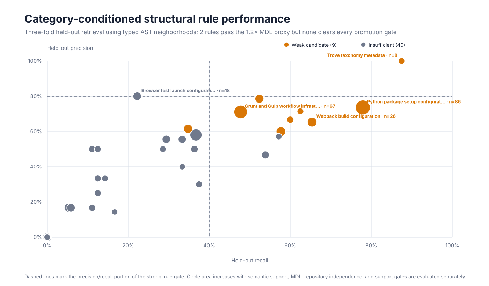

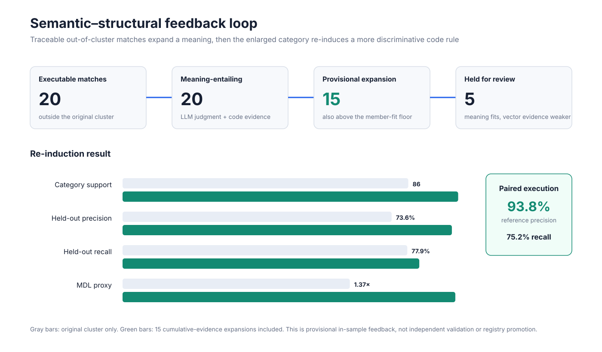

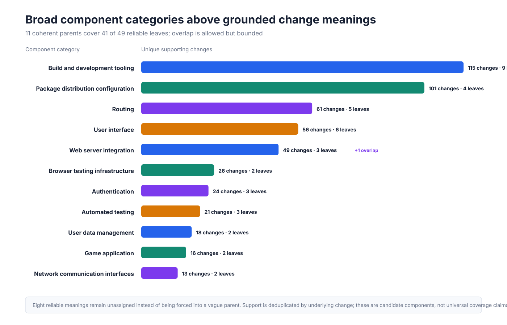

### Static component transfer to unseen repositories

The first transfer test applies the 11 broad parents to 80 static source files from 80
recorded-name-disjoint repositories. Commit text is withheld. Embedding similarity
retrieves candidate parents, but a constrained semantic adjudicator may reject every
candidate and propose a missing noun category instead of accepting the nearest vector.

| Static holdout outcome | Result | Interpretation |
|---|---:|---|
| Files / repository families | 80 / 80 | 40 Python and 40 JavaScript; no recorded alias overlap with discovery |
| Strong existing-category match | 47 (58.8%) | Code clearly implements one or two existing component responsibilities |
| Plausible existing-category match | 8 (10.0%) | Useful but partial category fit |
| Explicit abstention / vocabulary gap | 25 (31.2%) | No adequate existing category was forced |
| Total exploratory coverage | 55 (68.8%) | Strong plus plausible; not yet human-calibrated precision |
| Existing categories used | 11 of 11 | No broad parent was completely dormant on this holdout |
| Embedding recall@3 | 85.5% | A judged parent appeared among the top three vector candidates for 47 of 55 matched files |
| Recurring gap clusters | 5 | Each appears in two independent held-out files |
| Singleton gaps | 15 | Retained as evidence, not promoted from one example |

The five recurring omissions are **database schema migrations**, **content/search
indexing**, **system monitoring**, **hardware input integration**, and **string/text
processing algorithms**. The singleton gaps include state persistence, encoding and
compression, filesystem maintenance, image preprocessing, scientific data ingestion,
chat commands, and external-service automation. These are exactly the kind of broader
component responsibilities the next loop should discover from their code evidence.
They should not be inserted as hand-authored categories merely because their names seem
reasonable.

This result is encouraging but deliberately incomplete. It shows that the induced
parents transfer beyond change descriptions and that abstention exposes useful
coverage gaps. It does **not** establish 68.8% precision: the semantic judgments are
LLM-generated and require a human-labeled calibration sample. Static file excerpts are
also coarser than the eventual CodeArchitect unit hierarchy, so future evaluation must
separate module-, class-, and function-level components.

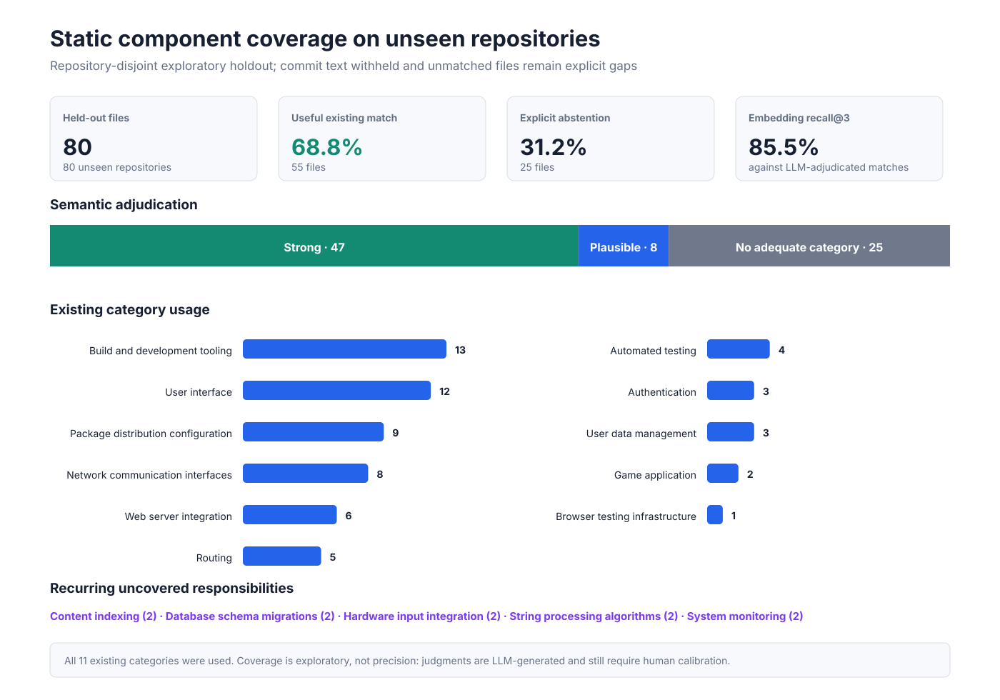

### Open-vocabulary gap feedback

The five recurring gaps then entered the same kind of retrieve-and-validate loop used
for change categories. Their member-meaning vectors retrieved 57 files above
seed-derived similarity floors from a larger pool of 500 files in 500
recorded-name-disjoint repositories. The semantic audit accepted only code that
materially implements the proposed responsibility; topical neighbors did not count.

| Gap candidate | Initial files | Accepted expansions | Total support | Pilot status |
|---|---:|---:|---:|---|
| String processing algorithms | 2 | 5 | 7 | Expanded candidate |
| Content indexing | 2 | 2 | 4 | Insufficient support |
| Database schema migrations | 2 | 2 | 4 | Insufficient support |
| Hardware input integration | 2 | 1 | 3 | Insufficient support |
| System monitoring | 2 | 0 | 2 | Insufficient support |

Only **String processing algorithms** clears the provisional five-file feedback floor.
Its accepted examples include expression parsing, title normalization, capitalization
and sanitization helpers, text-to-character-code conversion, and format validation.
The other four meanings remain traceable hypotheses rather than being promoted by
semantic similarity alone. Across all five searches, only 10 of 57 retrieved candidates
were accepted, demonstrating that the semantic audit is doing real filtering.

This is still a small support diagnostic, not the proposal's 50-repository/100-commit
promotion gate. The expanded category must next acquire a structural description of
the code relationships shared by its members and survive human meaning calibration.

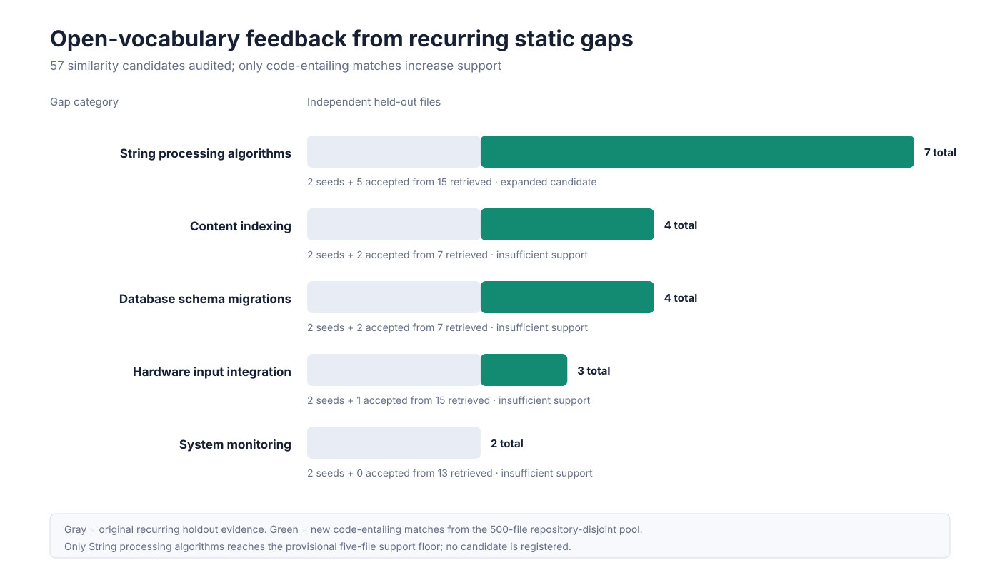

### Cross-language structural validation of the expanded gap

The seven-file **String processing algorithms** candidate was then tested as a possible
structural category. Complete source files for the same 500-repository pool were parsed
with Tree-sitter. Python and JavaScript nodes were normalized into cross-language roles
such as function, call, string, conditional, iteration, assignment, access, mapping,
sequence, and return. Candidate rules were bounded ORs of one-to-three-atom structural
clauses and excluded paths, commit text, and arbitrary local identifiers.

The best rule fitted on all seven examples contains two clauses. It matches three of
seven positives and one of 493 negatives: **75.0% in-sample precision, 42.9% recall,
and 54.5% F1**. This already misses most of the category. More importantly, across
seven leave-one-positive-out folds, the learned rules recover **0 of 7 held-out
positives** and produce nine repeated false-positive exposures. Held-out precision,
recall, and F1 are therefore all zero.

The correct decision is to keep **String processing algorithms** as a semantic-only
umbrella. Its members share a human-understandable responsibility but not yet a precise
recurring AST rule. The category must be split—likely into transformation versus
analysis/parsing responsibilities—or supported with more examples before another
structural attempt. Lowering the gate would turn a useful semantic grouping into a
misleading structural primitive.

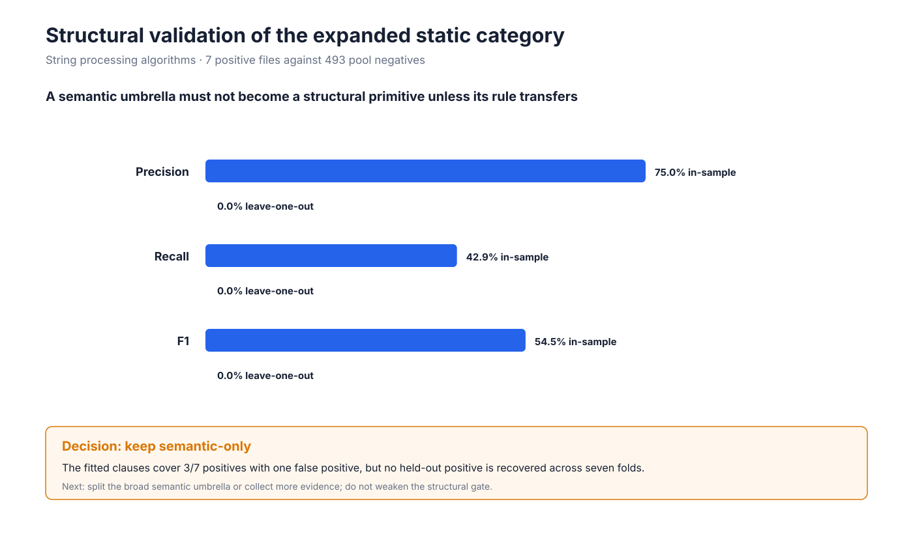

### Recursive split of the semantic-only umbrella

The failed structural category was sent back through the within-cluster loop. A
cosine-distance threshold sweep over the seven member meanings found a stable core at
0.44: two non-singleton groups cover five of seven members, with 0.184 silhouette and
0.898 subsample-stability ARI. Palindrome search and format validation remain residuals
rather than being forced into either child.

The semantic audit retained one two-file child, **Text normalization**, spanning title
cleanup and capitalization/sanitization. Its definition improves mean member fit over
the parent by 0.143. A proposed **Text filter pipelines** child loses the operator-parser
example during semantic audit and falls to one member, so it is rejected.

Text normalization first retrieved the top 20 candidates from the verified 500-file
repository-disjoint pool. None cleared the original seed-similarity floor, so retrieval
used a top-k fallback while preserving that fact in the audit record. Two files truly
entailed the child: username/channel canonicalization and blog-tag capitalization.

After explicit approval for the larger third-party source transfer, the pool expanded
to 2,000 files from 2,000 recorded-name-disjoint repositories and the top 40 candidates
were audited. Eight entail the category, raising support from two to **10 independent
files**. The new examples include Greek case/diacritic normalization, domain-label and
image-link cleanup, filename-safe series-title aliases, uppercase/whitespace
canonicalization, blog-tag formatting, and XML whitespace removal.

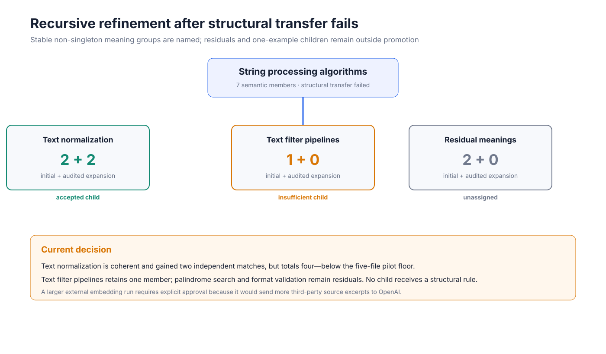

### Structural validation and second recursion for Text normalization

The 10-file child was evaluated against the other 1,990 files with the same normalized
AST rule learner. Its all-member fit improves to **87.5% precision, 70.0% recall, and
77.8% F1**. Leave-one-positive-out transfer remains weak, however: only two of 10
held-out positives are recovered, with five repeated false-positive exposures. Held-out
precision is **28.6%**, recall **20.0%**, and F1 **23.5%**, below the 80%/60% pilot
promotion thresholds. Text normalization therefore remains semantic-only despite
clearing the evidence floor.

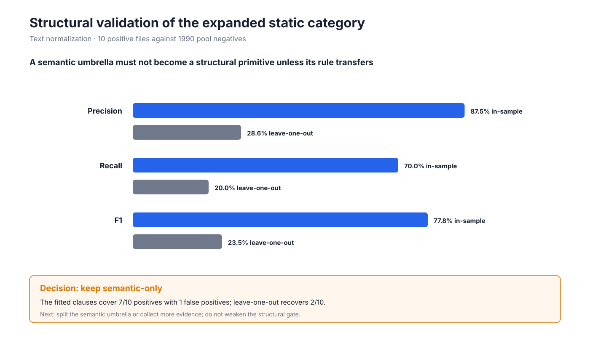

The recursion continued rather than weakening the structural threshold. A stable
three-group core at cosine distance 0.39 covers seven of 10 members (silhouette 0.370;
subsample-stability ARI 0.781). Semantic grounding then produces:

- **Filename-safe title sanitization**: two nearly identical `alias.js` examples,
  positive specificity gain of 0.269. Retained only as a provenance-warning candidate;
  matching paths and descriptions across recorded-name-disjoint repositories may
  reflect copied code.
- **Case normalization**: three examples, but its proposed child definition fits the
  members 0.052 worse than the Text normalization parent, so it fails the specificity
  gate.
- **Tag capitalization**: one retained example after an adjacent domain-label member is
  excluded, so it fails minimum child support.
- Three residuals remain unassigned: defective channel/username normalization, Greek
  case/diacritic normalization, and delegated XML whitespace cleanup.

No second-level child is promoted to a structural primitive. This is the intended
behavior of recursive composition: semantic parents remain useful descriptions while
only recurrent, transferable code relationships are allowed into the structural layer.

### First human calibration of component meanings

An initial low-friction calibration presented eight code summaries spanning strong
matches, borderline parents, open-vocabulary gaps, and the recursive normalization
branch. The reviewer judged all eight proposed categories to express the **right
semantic idea**, found no category clearly too narrow, and could not reliably judge
over-breadth from a single flat label. This is positive evidence for recognizability,
not a precision estimate: the batch is small, the reviewer saw summaries rather than
raw code, and breadth requires seeing both the parent and its candidate child.

The judge pass therefore separates two questions that the first prompt conflated:

| Example | Parent membership | Recommended child or refinement | Judge assessment |
|---|---|---|---|
| Signup/sign-in routes and redirects | Routing and authentication | Authentication-aware routing | Correct composite parent; child would preserve the relationship between its two bases |
| HTTP GET/POST response wrappers | Network communication interfaces | HTTP client utilities | Strong parent fit; reusable child is warranted |
| React course controls and inputs | User interface | Form interface | Strong parent fit; child is useful if supported beyond this domain |
| Cached module resolution and fallbacks | Build and development tooling | Module resolution | Parent family is correct but too broad to be the terminal explanation |
| Device-performance statistic collection | System monitoring | Device telemetry | Strong parent fit; child carries the code-grounded mechanism |
| Filtered retrieval from a search index | Content indexing | Search-index access | Family is plausible, but “indexing” overstates code that retrieves rather than constructs an index |
| Password generation by random sampling | Random value generation | Credential generation | Correct mechanism parent; intent-level child is more informative |
| Greek lowercasing and accent removal | Text normalization | Case and diacritic normalization | Strong parent fit and a clear, reusable child meaning |

The resulting calibration rule is: **a broad label is not rejected merely because a
more precise label exists**. The broad label is retained as a parent when membership is
clear, while a child is proposed only when its meaning is reusable and supported by
multiple independent code examples. Future human batches will ask separately whether
the parent is correct and whether the proposed child adds useful specificity.

### Pre-registered quality comparison

| Approach | Match coverage | Intent precision | Unique resolution | Human usefulness | vs Baseline | Notes |
|---|---:|---:|---:|---:|---:|---|
| Syntax-only GumTree verbalizer | TBD | TBD | n/a | TBD | — | Required baseline |
| Direct diff-to-label LLM | TBD | TBD | n/a | TBD | TBD | No reusable registry |
| Current CodeArchitect explanation path | 100%* | TBD | n/a | TBD | TBD | *Can attempt any parsed selection; not equivalent to a precise primitive match |
| Broad component vocabulary on static files | 68.8%† | TBD | Multi-label ≤2 | TBD | TBD | †Exploratory LLM-adjudicated coverage on 80 recorded-name-disjoint repositories |
| Atomic primitives only | TBD | TBD | TBD | TBD | TBD | Tests value of composites |
| Full Intent Algebra | TBD | TBD | TBD | TBD | TBD | Proposed final system |

- **Best explanation result**: TBD after frozen test evaluation; current numbers measure only pipeline behavior.
- **Improvement over baseline**: TBD; report absolute percentage-point differences and relative changes where meaningful.
- **Statistical confidence**: repository-clustered 95% bootstrap confidence intervals; paired significance tests for blinded human comparisons.
- **Required segment analysis**: Python versus JavaScript, one/two/three change components, repository family novelty, primitive support band, and atomic versus composite match.
- **Failure modes to count**: no match, overly broad match, contradictory overlap, wrong grounded meaning, name-sensitive match, semantically important literal erased, and matcher/compiler mismatch.

### Existing implementation evidence

The current working tree now contains an executable pilot in addition to existing CodeArchitect infrastructure:

- Tree-sitter parsing and structural unit selection already exist in `server/ingest/parseTree.js` and `server/ingest/frontier.js`.
- Direct LLM-based isolated and contextual meanings already exist in `server/llm/meaning.js`; this supplies a real product baseline.
- A persistent GumTree worker, deterministic corpus sampler, exclusion accounting, component grouping, subtree-preserving change-graph encoder, bounded gSpan runner, and grounding-queue builder now exist under `experiments/intent-algebra/`.
- A local human-review interface and written rubric now support independent review identities, evidence-first candidate inspection, saved judgments, and queue-version detection.
- A separate semantic-cluster interpretation screen now supports accept/reject/custom labels and stores cluster judgments independently from primitive grounding reviews.
- Twenty-four Node tests pass: three existing benchmark tests, twelve intent-pilot/facet tests, six primitive/cluster-review validation and storage tests, and three line/token diff-rendering tests.
- Semgrep 1.176.0 now executes two paired Python category prefilters across 1,533 reconstructed before/after pairs; a sample-ID join and GumTree clause verifier convert those source matches into change-pattern matches.
- A cached cumulative-evidence audit now loops traceable out-of-cluster matches back into semantic membership using meaning-vector fit plus LLM entailment, then re-induces and re-evaluates the structural rule.
- A repository-support analyzer now collapses multi-repository rows and shared repository names into observed provenance components instead of treating every listed alias as independent support.
- A grounded component hierarchy now groups 41 of 49 reliable change meanings into 11 broad, traceable component categories with bounded multi-parent overlap and explicit abstention for unmatched meanings.
- A repository-disjoint static transfer harness now evaluates complete source files without commit text, retrieves candidate parents from code embeddings, permits zero-to-two labels, and turns uncovered responsibilities into traceable growth candidates.
- A cached static-gap feedback loop now searches 500 additional unseen-repository files and audits retrieved code before increasing category support, expanding one of five recurring gaps while leaving four below the pilot floor.
- A cross-language static-structure inducer now abstracts Python/JavaScript ASTs into shared semantic roles and applies leave-one-positive-out validation, correctly withholding structural status from a seven-file category whose fitted rule does not transfer.
- A residual-aware recursive refinement now preserves singleton meanings outside child clusters, expands Text normalization to 10 audited repository-disjoint examples, rejects it structurally after weak leave-one-out transfer, and withholds three tempting second-level children on specificity, support, or provenance grounds.
- Held-out category-label MDL, structural-constituent MDL, and persisted-AST role-aware metamorphic probes are implemented for triage. Primitive registration, lattice resolution, source-reparse probes, complete edit-tree MDL, and explanation-quality benchmarks remain unimplemented.

## 5. Business / Practical Impact

### Expected impact if validated

- Make repeated code behaviors explainable through stable, auditable intent labels rather than fresh model phrasing on every request.
- Reduce LLM work by reusing a deterministic match and only asking a model to realize or contextualize the result when needed.
- Improve user trust by exposing the structural evidence and supporting examples behind an explanation.
- Create measurable abstention: CodeArchitect can say that no supported intent primitive matches instead of producing a confident but weakly grounded explanation.
- Provide a reusable intermediate representation for change summaries, code review, repository maps, and future explanation generation.

No time, cost, or comprehension improvement should be claimed until measured against the baselines. Phase 1 can establish registry quality; Phase 2 must test whether that registry actually improves the user-facing explanation.

### Decision recommendation

Continue **bounded scale-up with strict promotion gates**:

1. Pause broad human review and require candidate-level semantic context beyond a frequent edit fragment.
2. Preserve the addition-dominant cohort as an ablation while comparing it with semantic-boundary expansion on the same deterministic sample.
3. Use the completed 1,000-diff sweep to tune candidate quality, but defer repository-support claims until provenance enrichment identifies independent repository families.
4. Expand the semantic–structural feedback loop beyond the first two categories, prioritizing rules whose structural verifier adds discriminative evidence rather than merely repeating a source-context prefilter.
5. Freeze the schema, MDL definition, and evaluation rubric only after the revised pilot exposes failure modes.
6. Scale the corpus only if the pilot achieves acceptable precision and produces non-trivial recurring intents.

The main technical go/no-go question is not whether frequent subgraphs can be found; it is whether those subgraphs correspond to stable human intent rather than only common syntax.

### Production requirements

- Versioned, reproducible corpus and registry builds.
- License/provenance review and deletion handling for retained source examples.
- Deterministic paired before/after matcher execution with bounded latency.
- Registry migrations and semantic versioning when patterns or meanings change.
- Human review workflow for low-agreement labels and overlap conflicts.
- Runtime confidence/abstention policy and telemetry that does not expose source code.
- Product A/B test comparing comprehension, correctness, latency, and cost with the current explanation path.

## 6. Key Accomplishments (Write these as near-resume bullets)

Current, defensible pilot bullets:

- Built a deterministic Python/JavaScript change-mining pipeline over 109,014 CommitPackFT file pairs, with generated-code filtering, exact patch deduplication, auditable exclusion counts, and reproducible bottom-hash sampling.
- Implemented a persistent GumTree 4.0 analyzer that emits subtree-preserving edit graphs and reduced per-diff JVM startup overhead enough to process a 200-change AST pilot in seconds.
- Operationalized atomic-change eligibility as one to three semantic AST components, retaining 139 of 200 sampled changes while separately surfacing 56 multi-component and five parser-error cases for rubric review.
- Added a configurable AST-churn gate that retained 68 addition-dominant changes, cut the atomic cohort by 51.1%, and reduced a 3–10-node gSpan search from more than 60 seconds to approximately 1.1 seconds.
- Separated precise edit facets from fuzzy architectural concepts, producing noun-only entity records for all 68 additive changes and a reproducible soft-clustering probe with source-weighted lexical context.
- Added a content-addressed OpenAI embedding baseline over rich code-change evidence; a conservative cosine threshold grouped 18 of 68 pilot changes into six candidate macro-concepts while correctly leaving 50 sparse examples unclustered.
- Scaled the deterministic experiment to 1,000 sampled changes, retained 336 addition-dominant diffs, mined 33 bounded structural candidates, and clustered 137 changes into 39 traceable semantic/code groups while leaving 199 unsupported examples as singletons.
- Implemented recursive cluster-of-cluster candidate generation with child-cluster and sample pointers, then rejected five of six generated parents as semantically incoherent and retained Python build and packaging only as a provisional 13-change annotation.
- Expanded the nested experiment to 4,000 sampled diffs and 1,278 retained changes, grouped 672 changes into 169 semantic/code clusters, and used exact member tracking to distinguish 14 stable expansions from 19 partial, split, or dissolved pilot clusters.
- Implemented a gated downward semantic-recursion harness that expanded 169 roots into 199 traceable nodes through nine stable within-cluster splits, supported overlapping meanings while capping sibling memberships at two, and validated hierarchy invariants before export.
- Grounded 30 recursive semantic nodes using competing LLM meanings plus centroid/member consensus, yielding 15 high-, six medium-, four low-confidence meanings and five abstentions while showing positive specificity gain for all nine grounded parent-child pairs.
- Expanded semantic discovery to 10,000 deterministic diffs and 3,130 retained changes, producing 456 traceable clusters and 545 recursive nodes; grounded 77 supported nodes into 34 high-, 15 medium-, 15 low-confidence meanings and 13 abstentions.
- Added a child-specificity confidence gate after the larger sweep found two of 23 grounded children that did not improve fit over their parent, preventing geometrically coherent but non-specializing labels from being promoted.
- Induced held-out structural AND/OR rules for 49 grounded semantic nodes, added bounded typed AST neighborhoods around edits, produced two rules above the 1.2× MDL proxy, and still registered none because precision, support, and repository-independence gates remain unmet.
- Compiled two MDL-positive Python rules into paired Semgrep prefilters with GumTree edit verification; against the initial discovery-cluster reference, Trove reached 100% precision and 75% recall and package setup reached 75.3% precision and 70.9% recall across 1,533 reconstructed file pairs.
- Closed the first semantic–structural feedback loop by auditing 20 traceable out-of-cluster package changes, provisionally expanding 15, and re-inducing a 101-change rule with 90.1% held-out precision, 81.2% recall, and 2.00× classification-MDL compression.
- Audited provenance for 49 grounded categories and found one that clears both observed support proxies: 101 patch-distinct Python package setup changes across 101 known-name components and 184 raw repository aliases.
- Distinguished predictive label compression from composite-pattern compression, evaluating 81 multi-atom clauses and retaining one 25-match Grunt/Gulp structure at 1.50× while correctly marking atomic package and Trove rules MDL-inapplicable.
- Implemented role-aware metamorphic tests that preserved 589/589 clauses under local-name randomization and rejected 515/515 anchor mutations, including 100% results for package setup and Trove rules.
- Induced 11 broad component categories above 49 reliable change meanings, covering 41 meanings while preserving eight abstentions and a traceable cross-cutting overlap between build tooling and web-server integration.
- Evaluated the component vocabulary on 80 static Python/JavaScript files from 80 recorded-name-disjoint repositories, obtaining 68.8% exploratory coverage across all 11 parents while preserving 25 explicit gaps and surfacing five recurrent missing component concepts.
- Closed the first open-vocabulary component loop by auditing 57 gap-retrieval candidates from a 500-repository pool, accepting 10 code-entailing expansions and growing string-processing components from two to seven examples without promoting four weaker gaps.
- Tested the seven-file string-processing umbrella against 493 static negatives with normalized cross-language AST clauses; rejected structural promotion after its 75.0%/42.9% in-sample precision/recall collapsed to zero held-out recall across seven leave-one-out folds.
- Recursively split the failed structural umbrella with a 0.898-stability meaning partition, expanded Text normalization from two to 10 audited files across a 2,000-repository pool, and still withheld structural promotion after leave-one-out precision/recall reached only 28.6%/20.0%.
- Separated minimal queue discovery from flexible composite expansion across 1,933 addition-dominant changes with up to 32 components, caught a 22.8%-precision constraint retriever before registration, and collapsed 67 exact-host candidates into 45 unique contexts including 13 multi-base lattice intersections.
- Preserved directed edit semantics for undirected gSpan mining through relation-node encoding, then reduced 1,957 frequent fragments to 26 support-closed pilot candidates with structural-validity and labeled-supergraph checks.
- Created an auditable grounding queue that joins every pilot candidate to commit text, code excerpts, and provenance while explicitly withholding meanings that do not yet meet semantic or independence requirements.

Future result bullets must still wait for held-out human evaluation and must not call the 26 pilot candidates validated “intent primitives.”

## 7. Lessons Learned & Next Steps

### Lessons established during design

- A source-code pattern is not automatically a change pattern. Semgrep needs a before/after join and edit verification to represent the same object that GumTree and gSpan mine.
- “At most three AST subtrees” needs an operational connected-component definition; raw edit-action count would reject simple changes and admit unrelated ones unpredictably.
- Composition and specialization are different relationships. Keeping them separate is necessary for correct lattice traversal and concise overlap resolution.
- Identifier permutation tests name invariance, not semantic validity. Negative structural probes are necessary to show that a matcher depends on the behavior named by its label.
- Commit frequency is not independence. Forks, mirrors, cherry-picks, and repeated framework scaffolding can otherwise inflate support.
- The registry should abstain when a shared intent is not supported. Forcing every frequent graph into English would turn syntax regularity into fabricated semantics.
- Addition dominance is a useful cohort filter, not a semantic guarantee: a valid additive graph can still yield punctuation or generic-expression subgraphs unless candidate-level context is required.
- Orthogonal primitives and architectural topics are different representational layers. Database, cache, authentication, and similar concepts should overlap freely rather than being forced into the primitive lattice.
- Discovery-cluster membership is not exhaustive semantic ground truth. Structurally matched non-members must be audited as possible category expansions before they are counted as false positives.
- Change intent and repository component identity are different levels. Narrow, code-grounded change meanings should support broader multi-label component categories rather than being stretched into universal labels themselves.
- Repository-level breadth requires an open vocabulary. The first static transfer used all 11 induced parents but still abstained on 31.2% of files; recurring gaps are useful discovery input, not evaluation failures to hide with lower thresholds.
- Semantic coherence does not imply one shared syntax. The string-processing umbrella supports retrieval and human description, but its failed structural transfer shows that broad component parents must remain distinct from the narrower code patterns that explain them.

### Immediate next steps

1. Expand the first human calibration across a stratified sample of the 80 static judgments—strong, plausible, and abstaining—using separate parent-membership and child-specificity questions to estimate semantic precision and missing-category agreement.
2. Preserve Text normalization as a semantic parent, audit copied-code provenance for the two filename-safe title examples, and gather more independent evidence before retrying structural induction on any second-level child.
3. Enrich the 101-change package category with parent SHAs, fork/mirror relationships, timestamps, and commit-wide changed-file lists to validate the observed provenance proxy.
4. Run held-out semantic entailment and source-level mutation/reparse probes for package setup; its persisted-AST role-aware probes already pass globally.
5. Generalize the semantic–structural feedback loop and paired matchers to additional Python and JavaScript categories; evaluate complete edit-tree MDL only for multi-atom composites.
6. Implement the versioned category registry, relation-cycle checks, bounded multi-parent resolution, and explicit abstention.
7. Run the syntax-only, direct-LLM, retrieval, and current-CodeArchitect baselines before making explanation-quality or business-impact claims.

### Phase boundary

- **Phase 1 — current**: corpus → edit graphs → discovered patterns → grounded meanings → validated registry.
- **Phase 2 — deferred**: primitive-to-prose realization, Rational Speech Acts brevity optimization, multi-primitive discourse planning, and end-user explanation experiments.

## 8. Artifacts

### Existing

- Engineering reference: `README.md`
- Candidate corpus bucket: `https://huggingface.co/buckets/ajorge2/commitpackft-bucket`
- Upstream dataset: `https://huggingface.co/datasets/bigcode/commitpackft`
- Current LLM explanation baseline: `server/llm/meaning.js`
- Tree-sitter parsing: `server/ingest/parseTree.js`
- Structural tree and frontier selection: `server/ingest/frontier.js`, `server/ingest/tree.js`
- Existing benchmark harness: `scripts/benchmark-context.js`, `benchmarks/README.md`

### Created in this design pass

- Intent Algebra project and experiment report: `docs/intent-algebra-experiment-report.md`
- Pilot implementation and documentation: `experiments/intent-algebra/`
- Reproducible baseline, refinement, and scale-up commands: `npm run intent:pilot`, `intent:pilot:additive`, `intent:mine:additive`, `intent:facets:additive`, `intent:cluster:additive`, `intent:cluster:embeddings:additive`, `intent:sweep:*`, `intent:scale:*`, `intent:large:*`, and `intent:review`
- Report figures and generators: `docs/figures/intent-algebra/`, `docs/figures/intent-algebra-additive/`, `docs/figures/intent-algebra-sweep-500/`, `docs/figures/intent-algebra-sweep-2000/`, `experiments/intent-algebra/plot-pilot.py`, `cluster-concepts.py`, `cluster-embedding-concepts.py`, and `compare-cluster-stability.py`
- Per-base structural expansion prototype: `experiments/intent-algebra/expand-base-coedits.py`
- Semantic/structural alignment and downward-recursion harnesses: `experiments/intent-algebra/align-semantic-structural.py`, `refine-semantic-clusters.py`
- Broad-category induction and static transfer evaluation: `experiments/intent-algebra/build-component-category-hierarchy.py`, `evaluate-static-component-coverage.py`
- Versioned semantic review policy and pilot/sweep decisions: `experiments/intent-algebra/semantic-cluster-decisions.json`
- Human review interface and rubric: `experiments/intent-algebra/review-server.js`, `review-ui/`, and `HUMAN_REVIEW.md`
- Ignored local pilot artifacts: `.data/intent-pilot/summary.json`, `sample-results.jsonl`, `eligible-change-graphs.data`, `gspan-labels.json`, `graph-index.json`, `mined-patterns.json`, and `grounding-queue.jsonl`

### Planned

- Corpus manifest with repository family, license, commit SHA, language, split, and exclusion reason.
- Frozen canonical before/after change-graph schema and cross-language fixtures.
- Candidate-level semantic-boundary expansion and behavior-bearing context gate.
- gSpan discovery output and candidate-pruning report.
- Paired Semgrep rule registry with metavariable correspondence.
- Grounding prompt, evidence records, human-label rubric, and adjudicated evaluation set.
- Registry validator, lattice visualizer, overlap report, and metamorphic probe suite.
- Frozen benchmark results in JSON plus a human-readable model card/report.
- GitHub/demo links: TBD.
