# Intent Algebra Workflow Review Notes

**Started:** October 1, 2026

## Code-unit level

- The distinction between clustering functions, classes, modules, or files does not yet
  feel well justified.
- Do not treat function-only analysis as a settled architectural decision. It is a
  controlled pilot choice that must be tested against alternatives or replaced with a
  representation that can handle multiple code scales responsibly.

## Semantic input

- The LLM should not interpret source code to create the semantic description used for
  clustering.
- Semantic meaning should come from the natural-language diff message.
- Before any AST-sign computation, split each message into independent `(verb,
  noun/object)` pairs. Preserve the verb as `add`, `remove`, or `neutral/unclear`
  metadata for the later candidate-queue ordering. Embed and cluster the noun/object
  meaning as the semantic object.
- Code remains traceable evidence and is used later to verify whether the message-derived
  semantic idea corresponds to a recurring code pattern.
- This correction invalidates the code-grounded description stage of the current
  semantic-first function pilot; retain that run only as an ablation.

## Corpus eligibility

- Sample complete diff-message and code-diff pairs rather than extracting after-state
  functions before semantic discovery.
- Do not reject a record merely because it contains a balanced mixture of additions and
  removals. Preserve addition/removal dominance only as metadata and an evaluation
  segment, not as an eligibility gate or semantic clustering feature.
- Locate the edited AST nodes and preserve structurally distinct edit regions without
  forcing one final partition before alignment.
- Treat message-to-edit alignment as a weakly supervised mapping problem. Extract each
  semantic object mentioned by the message and infer its code alignment separately.
- Assign positive and negative evidence at the edit-object level, not once for the
  entire diff. Every distinct object explicitly or implicitly described by the message
  is a positive alignment, so one message can yield multiple labeled code examples.
  Structurally separate objects not supported by the message become negative or
  contextual evidence. Competing ancestor scopes around a positive edit are alternative
  candidate boundaries, not negative examples.
- A message may mention several semantic objects, but each receives its own alignment
  process and its own AST-candidate queue.
- Addition/removal dominance does not change this rule: even a strongly one-directional
  diff can contain several distinct objects that the message labels separately.

## Code-label-to-cluster transition

- Extract one or more semantic objects from each diff message while retaining the
  object-to-message and message-to-diff links. Process every mentioned semantic object
  separately.
- Run the AST candidate-queue alignment for every `(verb, noun/object)` pair before
  semantic clustering. Every independently supported AST node or subtree above the
  confidence threshold becomes a separate meaning–subtree datapoint for that pair.
  Unresolved pairs must remain explicitly unresolved rather than entering the cluster as
  if their entire diff were labeled.
- A code label is exactly one AST subtree from exactly one side of the diff. Never combine
  a before subtree and an after subtree into one paired code label. If one semantic claim
  aligns to relevant structure on both sides, emit two linked datapoints—one carrying the
  before-side subtree and one carrying the after-side subtree—while preserving their
  shared claim and diff provenance.
- Repeat extraction and alignment across many records to build a corpus-level collection
  of accepted meaning–subtree datapoints. Semantic clustering begins only after this
  collection exists; it is not triggered separately after each individual diff.
- Embed and cluster semantic objects only after their points carry traceable code labels.
  The semantic embedding still comes from the noun/object meaning, not from the code;
  the code label is retained so the code representations inside each resulting semantic
  cluster can be compared afterward.
- Assign every resulting cluster its own noun-only term based on all of its members. Two
  distinct clusters may not retain the same term; a collision requires merging the
  clusters or choosing a more specific distinguishing noun.
- Estimate semantic confidence immediately after naming. If confidence is below the
  acceptance threshold, skip that cluster and continue with the next candidate rather
  than spending structural-audit work on it.
- After naming a cluster, run the all-member structural audit before attempting any
  recursive clustering inside it. The audit determines whether the proposed semantic
  cluster corresponds to a recurring code pattern.
- Only a cluster that passes structural validation may be registered and searched for
  narrower semantic subclusters. After registration, make only that cluster's member
  embeddings the active embedding view and run clustering again inside that scoped view.
  Send every resulting child-cluster candidate back through the same naming, confidence,
  and structural-validation loop. Low-confidence or structurally invalid children are
  skipped; only valid children become terms and create another scoped embedding view.
- Once those message-derived semantic objects have been embedded and clustered, the cluster
  already has a semantic meaning. Do not add a redundant “dense semantic group”
  artifact or a second all-member semantic audit.
- Replace the all-member semantic audit with an **all-member structural audit** over the
  code diffs belonging to that semantic cluster.
- The structural audit must infer what the message-derived meaning looks like in code
  across all supporting examples.
- Structural templates must support metavariable-style placeholders for identifiers,
  expressions, values, calls, blocks, and other substitutable code roles. These are
  pattern placeholders, not literal Python variables.
- A template must also support optional structural elements so it can preserve real
  variation without forcing every member to have identical syntax. Optional elements
  should retain support statistics and must not make the matcher unconstrained.
- A reasonable representation to investigate is a small regex-like language over
  normalized AST node types, edit operations, and syntax relationships—not ordinary
  regex over raw source text. It could provide named placeholders, optional elements,
  repetition, and alternatives while retaining tree nesting. This remains an open
  design choice to compare with Semgrep templates or another tree-pattern DSL.

## Hyperparameter ownership and pilot defaults

The executor owns ambiguous numerical choices. Defaults are pre-registered in
`experiments/intent-algebra/semantic-first-hyperparameters.json`, tuned only on the
repository-disjoint validation split, and frozen before the final test evaluation.

| Stage | Pilot default | Purpose |
|---|---|---|
| Verb-sign use | confidence ≥ 0.80 | Otherwise treat the verb as neutral and skip sign buckets |
| Semantic-object extraction | confidence ≥ 0.65 | Otherwise leave that object unresolved |
| Message-to-code alignment | independent-support confidence ≥ 0.75 | Retain every sufficiently supported meaning–subtree pairing rather than forcing one winner |
| Embeddings | `text-embedding-3-large`, 1,024 dimensions, normalized cosine | Stable common space for nouns and candidate meanings |
| Local cluster size | `min(50, max(8, ceil(1% × view size)))` | Never create singleton or tiny semantic terms |
| Density requirement | `max(2, ceil(min cluster size / 3))` | Keep HDBSCAN from accepting weak chains |
| Recursion eligibility | parent size ≥ twice the local minimum; depth < 5 | Ensure room for non-trivial children and bound pathological recursion |
| Child specificity | child ≤ 90% of parent | Prevent the parent from reappearing unchanged as its own child |
| Split quality | cohesion gain ≥ 0.03; silhouette ≥ 0.10 | Require semantic improvement rather than arbitrary subdivision |
| Split stability | 20 repeats on 80% subsamples; mean ARI ≥ 0.70 | Reject fragile child memberships |
| Meaning confidence | accept medium/high; skip low/abstain | Spend structural-audit work only on identifiable meanings |
| AST-regex induction | 10 draws of 6–10 subtrees; ≤3 candidates per draw | Require a rule to be inferable from several small samples rather than all members at once |
| AST-regex complexity | ≤12 required atoms, 4 metavariables, 2 optional groups, depth 5 | Keep every rule inspectable and resistant to memorization |
| Rule-family size | ≤3 OR clauses; each adds ≥0.10 coverage | Permit several implementations without creating an unconstrained union |
| Sample stability | mean match-set Jaccard ≥0.80 | Reject rules that depend on a lucky small sample |
| Structural rule | coverage ≥ 0.60; precision ≥ 0.90 | Require the code rule to explain the category without becoming generic |
| Registry support | ≥ 100 patch-distinct commits and ≥ 50 independent repository families | Preserve the proposal's recurrence standard |
| Structural robustness | 100% identifier-permutation retention; ≥ 95% unrelated-mutation rejection | Verify that rules encode structure rather than names |
| Compression | MDL ratio ≥ 1.20 | Reject rules that do not justify their own complexity |

Recursive clustering stops when the maximum depth is reached, the scoped view is too
small for two non-trivial children, every child is below the minimum size, no candidate
split passes cohesion/silhouette/stability, every produced child is later skipped by the
confidence or structural gates, or a membership set repeats and would create a cycle.
“No child candidates” is therefore only one of several stopping conditions.

The full AST-regex grammar sketch, RANSAC-like sample-infer-execute loop, residual
OR-clause procedure, negative-corpus evaluation, and scaling strategy are specified in
`docs/intent-algebra-ast-regex-induction.md`.

## Run auditability

- The experiment executor writes a new immutable run directory; it never uses the
  notebook as a hidden computation step and never silently overwrites an artifact.
- Every record, message-derived claim, AST candidate, accepted code label, unresolved
  outcome, and review judgment has a stable ID. Foreign-key links preserve the complete
  route from a displayed result back to the original message, diff, and each accepted
  single-sided subtree.
- The run manifest freezes dataset identity, source hashes, Git revision, configuration,
  prompt and model versions, seeds, and environment metadata.
- Finalization validates linkage and the one-subtree/one-side invariant, then writes an
  artifact index containing byte lengths, row counts, and SHA-256 hashes. Any later file
  change becomes visible as a hash mismatch.
- The Python notebook is a read-only audit view. It displays the calibration funnel,
  highlighted diff, extracted verb+noun claims, the entire deduplicated candidate queue,
  all accepted subtrees and ASTs, abstentions, review sample, and metric slices. Rerunning it
  cannot change experiment results.
- Human review adds append-only judgments linked to model output; it does not replace or
  erase the original model decision.

## Edit-object candidate generation

- Do not force one definitive AST partition before message-to-code alignment. Generate
  candidates at multiple structural scales and let the evidence select among them.
- Starting from the edited AST nodes, include every meaningful node on the ancestor
  paths between each edited node and the relevant lowest common ancestors. For example,
  an edited statement nested in a body can yield candidates for the statement, the body,
  and the enclosing construct; the body must not be omitted merely because it was not
  itself the directly edited leaf.
- Generate relevant LCAs for subsets of edits rather than relying only on the single LCA
  of the entire diff, which may be an uninformative function, module, or file root.
- For each message-derived semantic object, retain single-node or single-subtree
  candidates at every meaningful scale. Structurally separate regions are evaluated
  independently.
- Give each semantic object its own priority queue. Use the following lexicographic
  ordering rather than a blended structural-similarity score:
  1. Preserve an immutable intrinsic operation on each raw edited AST node: insertion is
     `add`, deletion is `remove`, and update or move is `neutral`. Before queue sorting,
     derive a separate queue-only operation label for every candidate. A directly edited
     node that contains nested edits is aggregated like an LCA or intermediate path
     node: collect the immutable intrinsic operations of the candidate itself, when it
     is directly edited, and of all edited descendants. Treat the candidate's own
     operation as one item in the same multiset as its descendant operations. Label the
     queue entry `add` when additions are at least half of all collected edit operations;
     otherwise label it `remove` when removals are more than half; otherwise label it
     `neutral`. Thus a removed node containing one added descendant has one add among
     two operations and receives the queue-only label `add`. A candidate with no edits
     is `neutral`. The derived label must never overwrite the node's intrinsic operation
     or become input to an ancestor's calculation. Every ancestor independently
     aggregates the original immutable operations, preventing a queue-only relabeling
     from cascading upward.
  2. If and only if the message verb unambiguously specifies addition or removal for
     that semantic object, create exactly two operation buckets. The first bucket
     contains candidates whose queue-only label matches the verb's sign. The second
     contains every nonmatching candidate, combining the other sign and `neutral`
     candidates without distinguishing them further. Thus an additive verb yields
     `add` then `not-add`, while a removal verb yields `remove` then `not-remove`. If the
     verb is neutral or unclear, skip operation bucketing entirely and begin with the
     structural ordering.
  3. When exactly one AST node is edited, queue that edited node first and then walk its
     ancestor chain upward one node at a time through its parent, grandparent, and so on,
     ending at the file root. The file root is therefore the last candidate if evaluation
     reaches it.
  4. When multiple AST nodes are edited, give directly edited AST nodes structural tier 1.
  5. Give the overall LCA of the retained edit nodes structural tier 2.
  6. Give every distinct LCA produced by non-singleton proper subsets of the edit nodes
     structural tier 3, deduplicating subsets that resolve to the same AST node. Bound
     this search at 64 distinct subset LCAs or 4,096 attempted subsets per side so a
     large edit cannot create a combinatorial stall.
  7. Give the remaining meaningful nodes on the paths between the edited nodes and the
     overall LCA structural tier 4, traversed bottom-up breadth-first: direct parents
     nearest any edited node first, then progressively higher ancestors toward the LCA.
  8. When operation buckets are active, sort by operation bucket first and structural
     tier inside each bucket. When buckets are inactive, sort directly by structural
     tier.
- Within equal queue positions, use stable source order as the deterministic tiebreaker.
- Deduplicate across the entire queue by canonical AST-node identity, not only within an
  individual priority tier. If the same node is produced as a direct edit, an LCA, a
  subset LCA, or a path node, keep one queue entry at its highest-priority position and
  attach every generation path as provenance. A node may never be evaluated twice for
  the same semantic object.
- Queue priority controls evaluation order, not truth. Evaluate every candidate and emit
  every independently supporting meaning–subtree pair whose confidence reaches the
  threshold. Leave a semantic object unresolved only when no candidate qualifies.

## Revised experiment workflow

```mermaid
flowchart TB
    A[CommitPackFT Python and JavaScript records] --> B[Remove generated, lockfile, formatting-only, and unusable records]
    B --> C[Preserve each complete record: natural-language diff message plus full code diff]

    C --> D["1. Extract semantic objects<br/>Split each message into independent verb + noun/object pairs"]
    D --> E["For every pair:<br/>verb = add, remove, or neutral/unclear<br/>noun/object phrase = semantic object"]
    E --> F["2. Assign a code label before clustering<br/>Retrieve this pair's complete code diff"]
    F --> G[Parse before and after code into ASTs]
    G --> H["Locate raw edited AST nodes and store immutable intrinsic operations:<br/>insert = add, delete = remove, update or move = neutral"]
    H --> I[Create one independent candidate queue for this verb + noun/object pair]
    I --> J["Generate single-node or single-subtree candidates only:<br/>one edit = edited node, then each ancestor upward to the file root<br/>multiple edits = direct edits, overall LCA, subset LCAs, then remaining paths in bottom-up BFS from edits toward the LCA"]
    J --> K["Derive each candidate's queue-only sign from immutable operations:<br/>include the candidate itself if edited plus every edited descendant<br/>add if additions are at least half; remove if removals are over half; otherwise neutral<br/>never write this derived sign back"]
    K --> L{Does this pair's verb clearly specify add or remove?}
    L -- Yes --> M["Create exactly two buckets:<br/>matching queue sign first<br/>every nonmatching sign second"]
    L -- No --> N[Do not create sign buckets]
    M --> O[Sort by structural tier inside each bucket]
    N --> P[Sort directly by structural tier]
    O --> Q[Deduplicate globally by canonical AST-node identity]
    P --> Q
    Q --> R[Keep each node once at its highest-priority position and merge its provenance]
    R --> S[Evaluate candidates in queue order against this semantic object]
    S --> T[Score every candidate independently against this semantic object]
    T --> U[Emit every meaning–subtree datapoint above the confidence threshold; otherwise leave the pair unresolved]

    U --> UA["Repeat steps 1–2 across many records<br/>Collect a corpus of accepted meaning–subtree datapoints"]
    UA --> V["3. Semantic clustering over the collected datapoints<br/>Embed each noun/object meaning while preserving its verb, subtree, and alignment confidence"]
    V --> W[Cluster semantic objects by meaning]
    W --> X["For each cluster, the LLM proposes its own noun-only term from all members<br/>No two distinct clusters share the same term"]
    X --> Y[Estimate confidence from member agreement and embedding cohesion]
    Y --> YQ{Is semantic confidence high enough?}
    YQ -- No --> SKIP[Skip this cluster and continue with the next candidate cluster]
    YQ -- Yes --> AC["4. Structurally validate this semantic cluster<br/>Collect its single-sided AST-subtree code labels"]
    AC --> AD[Draw 10 small repository-stratified samples of 6–10 member subtrees]
    AD --> AE["Infer up to 3 bounded AST-regex candidates per sample<br/>using metavariables, optional elements, and bounded gaps"]
    AE --> AE2["Execute every rule across all member subtrees and the out-of-cluster corpus<br/>Fit up to 3 OR clauses to high-precision residual families"]
    AE2 --> AF[Validate coverage, precision, cross-sample stability, support, robustness, and MDL]
    AF --> AG{Does recurring code evidence support the semantic term?}
    AG -- Yes --> AH[Register noun-only meaning, structural rule, evidence, and confidence]
    AG -- No --> SKIP

    AH --> AJ[Link this valid term to the current parent scope]
    AJ --> Z["Make this validated cluster's member embeddings the new embedding view"]
    Z --> AA["Cluster the new embedding view with recursion gates:<br/>non-trivial child size, depth, proper-subset, cohesion, silhouette, stability, and cycle checks"]
    AA -- Each eligible child candidate --> X
    AA -- No candidate passes the recursion gates --> AK[This recursive branch is complete]
    AK --> AM[After all branches finish, connect overlaps and set differences and evaluate held-out coverage]

    AL["Key constraints:<br/>mixed add/remove diffs remain eligible<br/>one queue per semantic object"] -.-> I
```

