# Intent Algebra Workflow Review Notes

**Started:** October 1, 2026

## Code-unit level

- The distinction between clustering functions, classes, modules, or files does not yet
  feel well justified.
- Do not treat function-only analysis as a settled architectural decision. It is a
  controlled pilot choice that must be tested against alternatives or replaced with a
  representation that can handle multiple code scales responsibly.

## Semantic input

- The LLM should not interpret source code to create the semantic description used for
  clustering.
- Semantic meaning should come from the natural-language diff message.
- Before any AST-sign computation, split each message into independent `(verb,
  noun/object)` pairs. Preserve the verb as `add`, `remove`, or `neutral/unclear`
  metadata for the later candidate-queue ordering. Embed and cluster the noun/object
  meaning as the semantic object.
- Code remains traceable evidence and is used later to verify whether the message-derived
  semantic idea corresponds to a recurring code pattern.
- This correction invalidates the code-grounded description stage of the current
  semantic-first function pilot; retain that run only as an ablation.

## Corpus eligibility

- Sample complete diff-message and code-diff pairs rather than extracting after-state
  functions before semantic discovery.
- Do not reject a record merely because it contains a balanced mixture of additions and
  removals. Preserve addition/removal dominance only as metadata and an evaluation
  segment, not as an eligibility gate or semantic clustering feature.
- Locate the edited AST nodes and preserve structurally distinct edit regions without
  forcing one final partition before alignment.
- Treat message-to-edit alignment as a weakly supervised mapping problem. Extract each
  semantic object mentioned by the message and infer its code alignment separately.
- Assign positive and negative evidence at the edit-object level, not once for the
  entire diff. Every distinct object explicitly or implicitly described by the message
  is a positive alignment, so one message can yield multiple labeled code examples.
  Structurally separate objects not supported by the message become negative or
  contextual evidence. Competing ancestor scopes around a positive edit are alternative
  candidate boundaries, not negative examples.
- A message may mention several semantic objects, but each receives its own alignment
  process and its own AST-candidate queue. Do not package multiple semantic objects or
  structurally separate code regions into a composite candidate at this stage.
- Addition/removal dominance does not change this rule: even a strongly one-directional
  diff can contain several distinct objects that the message labels separately.

## Cluster-to-structure transition

- Extract one or more semantic objects from each diff message while retaining the
  object-to-message and message-to-diff links. Process every mentioned semantic object
  separately.
- Once those message-derived semantic objects have been embedded and clustered, the cluster
  already has a semantic meaning. Do not add a redundant “dense semantic group”
  artifact or a second all-member semantic audit.
- Replace the all-member semantic audit with an **all-member structural audit** over the
  code diffs belonging to that semantic cluster.
- The structural audit must infer what the message-derived meaning looks like in code
  across all supporting examples.
- Structural templates must support metavariable-style placeholders for identifiers,
  expressions, values, calls, blocks, and other substitutable code roles. These are
  pattern placeholders, not literal Python variables.
- A template must also support optional structural elements so it can preserve real
  variation without forcing every member to have identical syntax. Optional elements
  should retain support statistics and must not make the matcher unconstrained.
- A reasonable representation to investigate is a small regex-like language over
  normalized AST node types, edit operations, and syntax relationships—not ordinary
  regex over raw source text. It could provide named placeholders, optional elements,
  repetition, and alternatives while retaining tree nesting. This remains an open
  design choice to compare with Semgrep templates or another tree-pattern DSL.

## Edit-object candidate generation

- Do not force one definitive AST partition before message-to-code alignment. Generate
  candidates at multiple structural scales and let the evidence select among them.
- Starting from the edited AST nodes, include every meaningful node on the ancestor
  paths between each edited node and the relevant lowest common ancestors. For example,
  an edited statement nested in a body can yield candidates for the statement, the body,
  and the enclosing construct; the body must not be omitted merely because it was not
  itself the directly edited leaf.
- Generate relevant LCAs for subsets of edits rather than relying only on the single LCA
  of the entire diff, which may be an uninformative function, module, or file root.
- For each message-derived semantic object, retain single-node or single-subtree
  candidates at every meaningful scale. Structurally separate regions may both be
  evaluated independently, but they are not packaged into a composite candidate.
- Give each semantic object its own priority queue. Use the following lexicographic
  ordering rather than a blended structural-similarity score:
  1. Preserve an immutable intrinsic operation on each raw edited AST node: insertion is
     `add`, deletion is `remove`, and update or move is `neutral`. Before queue sorting,
     derive a separate queue-only operation label for every candidate. A directly edited
     node that contains nested edits is aggregated like an LCA or intermediate path
     node: collect the immutable intrinsic operations of the candidate itself, when it
     is directly edited, and of all edited descendants. Treat the candidate's own
     operation as one item in the same multiset as its descendant operations. Label the
     queue entry `add` when additions are at least half of all collected edit operations;
     otherwise label it `remove` when removals are more than half; otherwise label it
     `neutral`. Thus a removed node containing one added descendant has one add among
     two operations and receives the queue-only label `add`. A candidate with no edits
     is `neutral`. The derived label must never overwrite the node's intrinsic operation
     or become input to an ancestor's calculation. Every ancestor independently
     aggregates the original immutable operations, preventing a queue-only relabeling
     from cascading upward.
  2. If and only if the message verb unambiguously specifies addition or removal for
     that semantic object, create exactly two operation buckets. The first bucket
     contains candidates whose queue-only label matches the verb's sign. The second
     contains every nonmatching candidate, combining the other sign and `neutral`
     candidates without distinguishing them further. Thus an additive verb yields
     `add` then `not-add`, while a removal verb yields `remove` then `not-remove`. If the
     verb is neutral or unclear, skip operation bucketing entirely and begin with the
     structural ordering.
  3. Give directly edited AST nodes structural tier 1.
  4. Give the overall LCA of the retained edit nodes structural tier 2.
  5. Give every distinct LCA produced by non-singleton proper subsets of the edit nodes
     structural tier 3, deduplicating subsets that resolve to the same AST node.
  6. Give the remaining meaningful nodes on the paths from the overall LCA down toward
     the edited nodes structural tier 4, traversed breadth-first in the downward
     direction.
  7. When operation buckets are active, sort by operation bucket first and structural
     tier inside each bucket. When buckets are inactive, sort directly by structural
     tier.
- Within equal queue positions, use stable source order as the deterministic tiebreaker.
- Deduplicate across the entire queue by canonical AST-node identity, not only within an
  individual priority tier. If the same node is produced as a direct edit, an LCA, a
  subset LCA, or a path node, keep one queue entry at its highest-priority position and
  attach every generation path as provenance. A node may never be evaluated twice for
  the same semantic object.
- The single-edit case needs an explicit upper boundary because its LCA is the edit node
  itself and therefore produces no ancestor path. Preserve this as an open design edge
  case so meaningful enclosing candidates such as a body are not accidentally omitted.
- Queue priority controls evaluation order, not truth. Preserve competing candidates
  until alignment evidence clearly separates them, and leave a semantic object
  unresolved when the evidence is insufficient.

## Revised experiment workflow

```mermaid
flowchart TB
    A[CommitPackFT Python and JavaScript records] --> B[Remove generated, lockfile, formatting-only, and unusable records]
    B --> C[Preserve each complete record: natural-language diff message plus full code diff]

    C --> D["1. Message semantics<br/>Split each message into independent verb + noun/object pairs"]
    D --> E["For every pair:<br/>verb = add, remove, or neutral/unclear<br/>noun/object phrase = semantic object"]
    E --> F[Embed the noun/object meaning while preserving the verb with the record]
    F --> G[Cluster semantic objects by meaning]
    G --> H[LLM proposes a noun-only term from all cluster members]
    H --> I[Estimate confidence from member agreement and embedding cohesion]
    I --> J{Stable semantic subgroups remain?}
    J -- Yes --> K[Re-cluster member semantic objects inside this cluster]
    K --> H
    J -- No --> L[Semantic cluster branch ready for structural grounding]

    L --> M["2. Structural evidence<br/>Retrieve every member pair's complete code diff"]
    M --> N[Parse before and after code into ASTs]
    N --> O["Locate raw edited AST nodes and store immutable intrinsic operations:<br/>insert = add, delete = remove, update or move = neutral"]

    O --> P["3. Per-object alignment<br/>Create one independent candidate queue for each verb + noun/object pair"]
    P --> Q["Generate single-node or single-subtree candidates only:<br/>tier 1 = direct edit nodes<br/>tier 2 = overall LCA<br/>tier 3 = unique subset LCAs<br/>tier 4 = remaining LCA-to-edit path nodes in downward BFS"]
    Q --> R["Derive each candidate's queue-only sign from immutable operations:<br/>include the candidate itself if edited plus every edited descendant<br/>add if additions are at least half; remove if removals are over half; otherwise neutral<br/>never write this derived sign back"]
    R --> S{Does this pair's verb clearly specify add or remove?}
    S -- Yes --> T["Create exactly two buckets:<br/>matching queue sign first<br/>every nonmatching sign second"]
    S -- No --> U[Do not create sign buckets]
    T --> V[Sort by structural tier inside each bucket]
    U --> W[Sort directly by structural tier]
    V --> X[Deduplicate globally by canonical AST-node identity]
    W --> X
    X --> Y[Keep each node once at its highest-priority position and merge its provenance]
    Y --> Z[Evaluate candidates in queue order against this semantic object]
    Z --> AA[Select the supported node/subtree or leave the pair unresolved]

    AA --> AB["4. Structural verification<br/>Collect selected alignments from all members of the semantic cluster"]
    AB --> AC[Run the all-member structural audit]
    AC --> AD[Infer a recurring AST edit rule with metavariables and optional elements]
    AD --> AE[Validate coverage, negative evidence, repository and commit support, confidence, and MDL]
    AE --> AF{Does recurring code evidence support the semantic term?}
    AF -- Yes --> AG[Register noun-only meaning, structural rule, evidence, and confidence]
    AF -- No --> AH[Leave ungrounded or refine the message-derived semantic cluster]
    AH --> K

    AG --> AI[Connect broader, narrower, overlapping, and set-difference terms]
    AI --> AJ[Evaluate taxonomy coverage on held-out repositories]

    AK["Rules carried throughout:<br/>no add/remove corpus filter<br/>no composite candidates<br/>one queue per semantic object<br/>single-edit upper boundary remains open"] -.-> P
```

