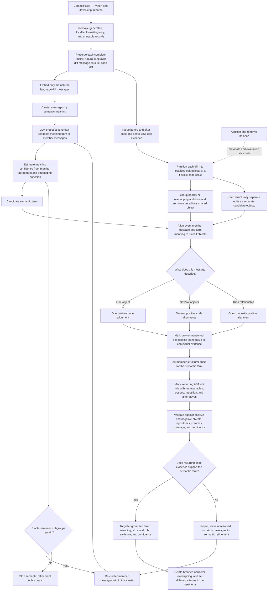

# Intent Algebra Workflow Review Notes

**Started:** October 1, 2026

## Code-unit level

- The distinction between clustering functions, classes, modules, or files does not yet
  feel well justified.
- Do not treat function-only analysis as a settled architectural decision. It is a
  controlled pilot choice that must be tested against alternatives or replaced with a
  representation that can handle multiple code scales responsibly.

## Semantic input

- The LLM should not interpret source code to create the semantic description used for
  clustering.
- Semantic meaning should come from the natural-language diff message.
- Code remains traceable evidence and is used later to verify whether the message-derived
  semantic idea corresponds to a recurring code pattern.
- This correction invalidates the code-grounded description stage of the current
  semantic-first function pilot; retain that run only as an ablation.

## Corpus eligibility

- Sample complete diff-message and code-diff pairs rather than extracting after-state
  functions before semantic discovery.
- Do not reject a record merely because it contains a balanced mixture of additions and
  removals. Preserve addition/removal dominance only as metadata and an evaluation
  segment, not as an eligibility gate or semantic clustering feature.
- Partition each diff into localized edit objects. Nearby or overlapping additions and
  removals likely describe one changed object; structurally separate edits remain
  separate candidate objects.
- Treat message-to-edit alignment as a weakly supervised mapping problem. For each
  record, infer which edit object, combination of objects, or shared changed region the
  message describes.
- Assign positive and negative evidence at the edit-object level, not once for the
  entire diff. Every distinct object explicitly or implicitly described by the message
  is a positive alignment, so one message can yield multiple labeled code examples.
  Objects not supported by the message become negative or contextual evidence.
- A message may describe one object, several objects, or a composite relationship. The
  structural audit must distinguish those cases instead of assuming the whole diff is
  positive.
- Addition/removal dominance does not change this rule: even a strongly one-directional
  diff can contain several distinct objects that the message labels separately.

## Cluster-to-structure transition

- Once diff messages have been embedded and clustered, the cluster already has a
  semantic meaning. Do not add a redundant “dense semantic group” artifact or a second
  all-member semantic audit.
- Replace the all-member semantic audit with an **all-member structural audit** over the
  code diffs belonging to that semantic cluster.
- The structural audit must infer what the message-derived meaning looks like in code
  across all supporting examples.
- Structural templates must support metavariable-style placeholders for identifiers,
  expressions, values, calls, blocks, and other substitutable code roles. These are
  pattern placeholders, not literal Python variables.
- A template must also support optional structural elements so it can preserve real
  variation without forcing every member to have identical syntax. Optional elements
  should retain support statistics and must not make the matcher unconstrained.
- A reasonable representation to investigate is a small regex-like language over
  normalized AST node types, edit operations, and syntax relationships—not ordinary
  regex over raw source text. It could provide named placeholders, optional elements,
  repetition, and alternatives while retaining tree nesting. This remains an open
  design choice to compare with Semgrep templates or another tree-pattern DSL.

## Revised experiment workflow

